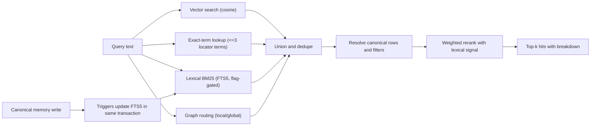

# BM25 lexical candidates design

## Context

Retrieval today unions independent discoveries in `MemoryService.SearchHybrid`: vector candidates from the retrieval engine, exact-term candidates from `SearchTerms`, and bounded graph evidence. Candidates that did not come from vector search are scored by `RetrievalEngine.ScoreCandidates`, which deliberately skips the semantic floor so low-cosine but connected evidence survives. A lexical stream fits this seam without a new execution model.

## Architecture

## Key decisions and alternatives

### D1: Standalone FTS5 table plus integer doc-id mapping, maintained by triggers

Options considered:

1. External-content FTS5 keyed by `memories.rowid`. Smallest storage, but `memories` has a text primary key, so its implicit rowid is not stable across a full `VACUUM`; a renumbered rowid would silently attach text to the wrong memory. Rejected for correctness.
2. Standalone FTS5 with an UNINDEXED `memory_id` column. Correct and simple, but deleting by `memory_id` scans the whole FTS content. Rejected for bulk eviction cost.
3. Standalone FTS5 whose rowid is an application-owned integer from a small mapping table keyed by `memory_id`. Deletes and updates are logarithmic and independent of `memories.rowid`. Chosen. Cost: one extra narrow table and duplicated text storage (roughly the content size).

Triggers rather than application-layer sync: memory rows are written and deleted from several code paths (write pipeline, lifecycle, audit eviction, retrieval feedback supersession, note chunk cascades). Triggers cover all current and future paths and preserve atomicity. Update triggers are column-scoped so counter-only updates never fire them.

### D2: Fusion by explainable lexical signal, not score addition

BM25 scores are unbounded and corpus-relative, cosine is bounded. The lexical score is normalized relative to the best lexical hit of the same query and enters the existing weighted activation as one extra signal with its own weight, defaulting to zero when the stream is off. Alternatives:

- Reciprocal-rank fusion: needs no calibration but discards magnitude and would replace the established weighted-activation contract; kept as a comparison arm in the harness only.
- Candidate-only (weight zero): lexical discoveries enter but are ranked by existing signals. Kept as a comparison arm to separate stream value from signal value.

### D3: Query construction

Lowercased word/number/underscore tokens are extracted, stop terms and tokens shorter than two characters dropped, duplicates removed, count capped at eight, and each is quoted and joined with OR so BM25 itself ranks by coverage and rarity. AND semantics are rejected as too brittle for natural-language queries. Prefix and NEAR operators are not exposed.

### D4: Tokenizer

Porter stemming over `unicode61` with diacritic removal and underscore kept inside tokens. Rationale: English-heavy engineering notes benefit from stemming; identifiers with underscores stay whole. Limitation: CamelCase and dotted paths are single tokens; the exact-term path and the vector path cover those. A trigram variant is a documented follow-up if the report shows identifier misses.

### D4a: Query shape and filters

Measured on 3,000 documents, an OR query whose terms match every document costs roughly 30-80 ms, almost entirely FTS matching and BM25 scoring (about 10 microseconds per matched document), not the canonical joins. The implemented shape ranks the best candidates inside the FTS scan (with the workspace or edition restriction stored as an UNINDEXED FTS column so other workspaces and unauthorized editions never compete for slots), then resolves those rows against canonical tables (supersession, source deletions) and widens the fetch only when canonical filtering leaves fewer rows than requested. Query terms are capped at eight. Alternatives considered and left as follow-ups: document-frequency pruning of very common terms (needs FTS5 vocab and stemmed lookups), and an AND-first pass with OR fallback.

### D4b: Connection warmup

FTS5 reads its configuration while the schema is parsed. On a fresh pooled connection that parse happened inside the first write transaction, opening a read snapshot; the later write upgrade then failed immediately with SQLITE_BUSY when another writer was active (reproduced by `TestConcurrentUpserts`, 3 of 3 runs). Every new connection therefore loads the schema, including both FTS5 tables, through a connection hook before any transaction. Alternative rejected: global `BEGIN IMMEDIATE`, which would serialize read-only transactions behind writers.

### D5: Fail-open and availability

The migration creates the index only when the FTS5 module is present and otherwise records itself as applied; runtime probes the table once per store and caches availability. Every lexical call is wrapped so that errors degrade to the existing candidate set and are counted, never surfaced as a search failure.

### D6: Passage search

Passages have their own mapping table and FTS5 table keyed by passage ID, maintained by triggers on `source_passages` (cascade deletes from editions fire them). The retrieval package keeps its authorization-first flow: resource policies are evaluated, authorized edition IDs are computed, and only then is the index consulted with an edition constraint chunked below SQLite parameter limits. Without the index the previous scan runs unchanged.

### D6a: Independent passage-ranking flag

The first implementation tied passage ranking to the memory lexical mode. The comparison showed the two streams have different evidence: the memory stream is gated on a real-embedder run because its gain sits on top of cosine, while the passage comparison is lexical against lexical (BM25 versus a substring-count scan) and does not depend on any embedding model. Options considered:

1. Keep one shared flag. Simplest, but promoting the proven passage win would force the unproven memory stream on with it. Rejected.
2. Passage mode as a tri-state that inherits the lexical mode when unset. Preserves the earlier behavior but adds a third state and an implicit coupling that the split exists to remove. Rejected; the earlier coupling was never released, so there is nothing to stay compatible with.
3. Two independent two-state flags, both defaulting to `off`. Chosen.

The default stays `off` because `docs/retrieval-ablation-decision.md` requires a versioned report showing improved continuation value before any stream becomes a default; the passage numbers support promotion but a default change is a separate, reviewable one-line decision. The rollout flag is read per request through the engine runtime flags, so toggling it needs no restart of tests or tooling that set the environment.

## Data contracts

- Migration 32 creates `memory_lexical_docs` (doc id, memory id unique, workspace), `memory_lexical_fts` (content and metadata columns), `passage_lexical_docs`, `passage_lexical_fts`, their triggers, and backfills in one pass.
- Store lexical query returns memory ID, BM25 score (positive, higher is better) and rank for one workspace excluding superseded rows, ordered by score then ID for determinism.
- `SignalBreakdown` gains an optional lexical component omitted from JSON when zero so existing consumers are unaffected.
- Runtime modes are read from two environment variables with `off` default: `AGENT_MEMORY_LEXICAL_MODE` for the memory stream and `AGENT_MEMORY_PASSAGE_RANKING_MODE` for passage ranking; lexical weight has a documented default used only when the memory mode is `on`.

## Failure modes and edge cases

| Case | Behavior |
|---|---|
| FTS5 module missing | Migration succeeds without index; stream reports unavailable; search unchanged |
| Index drift after manual DB edits | A status/rebuild operation compares row counts and can rebuild from canonical rows |
| Empty or stopword-only query | No lexical candidates, no error |
| Malformed FTS grammar in input | Impossible by construction: only quoted word tokens are emitted |
| Superseded or deleted memory still in index | Excluded by SQL join and rechecked by canonical resolution |
| Cross-workspace rows | Filtered by workspace in SQL and by canonical recheck |
| Very large workspace backfill | Single synchronous pass; documented cost; no startup abort on empty FTS |
| Concurrent writers | Index writes occur inside the writer transaction, so readers see consistent state |
| BM25 ties | Deterministic secondary order by memory ID |

## Performance and scaling

Indexing adds one narrow insert and one FTS insert per memory write. Query cost is index-bound and independent of embedding computation. Expected benefit is quality on rare tokens and independence from the embedding provider; speed is not the goal at current corpus sizes. The harness records latency and index size so the claim is measured, not assumed.

## Security and privacy

The index stores text already present in the database and inherits its file permissions. Redaction applies before canonical storage, so the index contains the same redacted text. Hard deletes remove index rows through triggers. No content leaves the database.

## Rollout

1. Land schema and store operations with no behavior change (`off`).
2. Land the flag-gated stream and passage swap with tests, each behind its own flag (memory stream: `AGENT_MEMORY_LEXICAL_MODE`; passage ranking: `AGENT_MEMORY_PASSAGE_RANKING_MODE`).
3. Run the comparison harness; publish the report in this spec directory.
4. Only if the report supports it, a separate change proposes enabling `on` by default and evaluating removal of the Bloom machinery and absorption of the exact-term table. The passage flag can be promoted first because its evidence does not depend on an embedding model. Rollback at any stage is setting the relevant mode to `off`.

## Risks

- Quality gain may be small on corpora with strong embeddings: mitigated by the flag and the report gate.
- Duplicated text increases database size: measured and reported.
- Stemming may over-match: visible in the comparison arms.
- Comparison harness may lack a real embedding model on some machines: the report states the embedder used and its limits.
