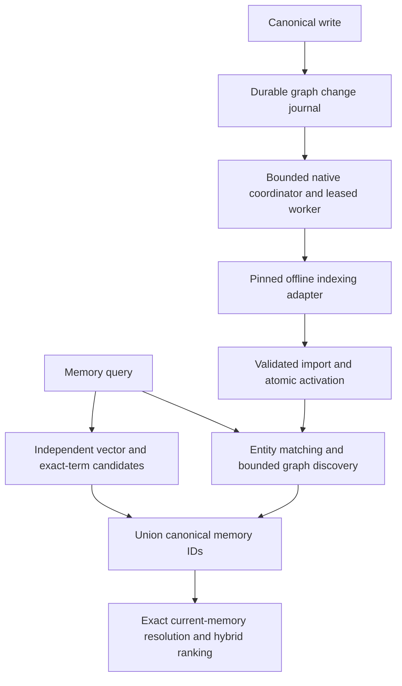

# Native graph indexing and hybrid retrieval design

## Persisted runtime settings for isolated verification

CLI startup reloads its persisted environment file and gives that file precedence over process variables. Merely setting a synthetic adapter in a subprocess environment therefore does not isolate a daemon smoke. Support an explicit absolute `AGENT_MEMORY_ENV_FILE` for both loading settings and writing toggles, while preserving the default user file and current precedence. The choice propagates naturally to detached daemon children through their environment. Missing selected files never fall back to the user's file; invalid relative selections stop loading with a warning. This avoids changing the user's home directory or persisted settings during verification. Changing global precedence was rejected because it would change existing toggle behavior; temporarily editing the real settings file was rejected because it would interfere with concurrent invocations.

## Current state and gaps

The installed 0.7 runtime and repository revision 028f414 contain canonical graph-change journaling, scoped graph jobs/revisions, normalized import/activation, query expansion and the pinned Python runner. The native daemon schedules lifecycle maintenance but does not consume graph jobs. Plain search uses vector retrieval; recall alone exposes graph enrichment. Existing terminal interface changes are independent and must be preserved.

## Architecture and contracts

Use the existing SQLite/application contracts and adapter runner. A transport-neutral native worker coordinates enabled workspace configurations, obtains immutable canonical projections and cutoffs, leases queued work, executes the adapter, validates normalized output, imports and activates complete revisions. The daemon owns worker startup/shutdown separately from lifecycle maintenance. Processing is bounded and does not run on writes or online queries.

The pinned adapter supplies the standard document metadata that upstream loaders normally create when passing a DataFrame directly, including numeric document ordinals. Incremental community merging also reconciles memberships through the upstream entity merge mapping and validates every resolved membership against the complete merged entity set before state cleanup. An adapter-owned workflow wraps the pinned community merge; upstream registry entries and strict artifact normalization remain unchanged. Offline tests run the actual installed document and graph merge workflows without model calls, while the opt-in local-model proof validates full and incremental artifacts end to end. Workflow error diagnostics expose a bounded stage and exception class without raw exception text.

The durable job identity binds workspace/configuration/revision, idempotency key and attempt. Lease ownership is renewed and checked before publishing state. A job cutoff binds only captured journal identities; later inserts remain pending. A complete activation transaction verifies candidate readiness, expected active revision, current enabled configuration and live lease before changing active state and marking captured changes processed. Retained adapter state is revision-scoped and protected with private paths and manifests; missing/incompatible state requires rebuild. Delete/supersession data must be checked against canonical storage before import/query.

The shared hybrid search application surface wraps basic candidate retrieval. Entity/alias matches and direct vector/term seeds drive bounded graph expansion. Merge their canonical memory IDs with independent direct candidates, resolve current records by ID, score graph-discovered memories semantically without treating the vector floor as an exclusive gate, and rank with path/evidence/trust plus lifecycle signals. Exact-term hits and direct vector hits remain present even when graph discovery succeeds. Search responses retain existing fields and add optional route/context metadata. CLI and HTTP accept the same graph settings; legacy terms and memory-relation expansion stay explicit.

## Alternatives and trade-offs

Graph-first with vector fallback only on empty/error results was rejected because nonempty graph results can miss newly inserted memories or unextracted concepts. Restricting vector retrieval to graph-returned IDs has the same coverage defect. Hybrid candidate union costs an additional bounded retrieval pass but preserves direct matches. Existing graph-assisted recall is reused instead of introducing a second graph schema or upstream GraphRAG query service. A synchronous per-write index was rejected because model latency and failure must not delay canonical writes. Periodic shell automation was rejected in favor of the existing native daemon and durable jobs.

## Failure modes and edge cases

Unavailable adapter/models, resource rejection, invalid manifests, unknown correlations, hash/schema mismatches and lost leases fail the job with sanitized reason codes; the previous active revision and basic retrieval remain usable. Cancellation terminates the adapter process group and cannot activate output. Shutdown waits for cancellation and lease disposition. Crashes leave recoverable leased work. Stale graphs fall back by default; explicit stale mode revalidates canonical evidence. Empty/suppressed corpora do not activate fabricated graphs. Configuration changes invalidate in-flight publication. Updates that arrive during indexing survive cutoff reconciliation. Expired/missing incremental state forces a full build; partial state is never used as a base. Conflicting graph paths remain separate from supporting evidence, and proposed edges have reduced influence.

## Performance and scaling

Reuse existing graph limits (50 changes or 15-minute maximum coalescing wait, projection/resource/attempt ceilings) with immediate first-build/operator jobs. Begin with one active local adapter operation to bound RAM, and visit registered projects fairly. Lease heartbeat and cancellation checks run independently of long adapter execution. Query snapshots/traversal are bounded by existing limits; canonical records are fetched in batches where available and no query starts Python. Candidate union and reranking have explicit caps. A stale graph still cannot suppress a fresh vector hit.

## Rollout and validation

First land scoped storage/fencing and synthetic worker regressions, then worker execution and daemon wiring, then hybrid search and CLI/API parity. Existing enabled project configurations are the indexing opt-in; runtime graph enablement remains required. Validate with isolated fake-adapter and real packaged local-model smoke data before installing the PATH binary and starting the daemon. Observe authoritative job/revision/pending state for operational rollout; do not claim a real project indexed until its active revision proves it. Preserve independent worktree changes and document any unresolved runtime evidence in tasks rather than marking it complete.
