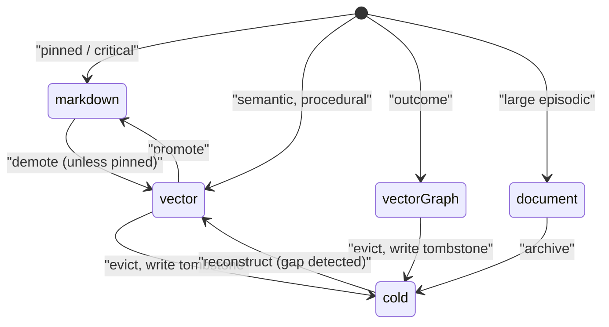
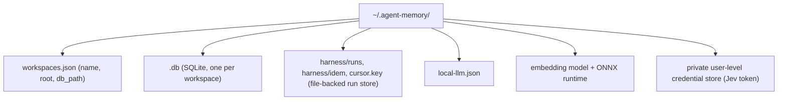
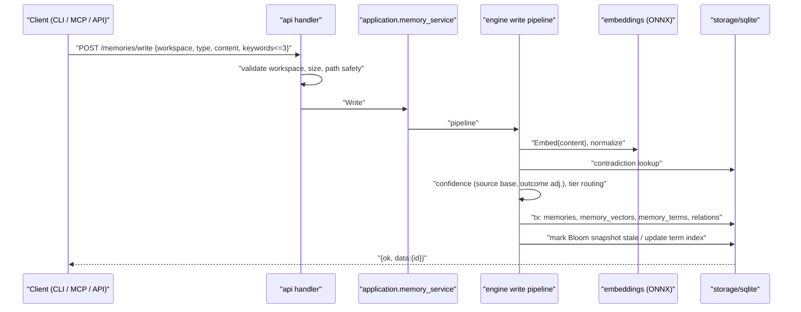
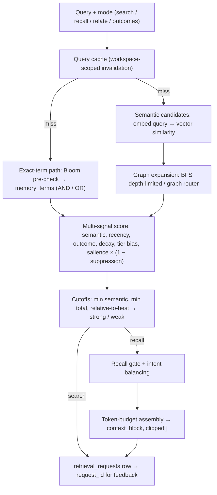
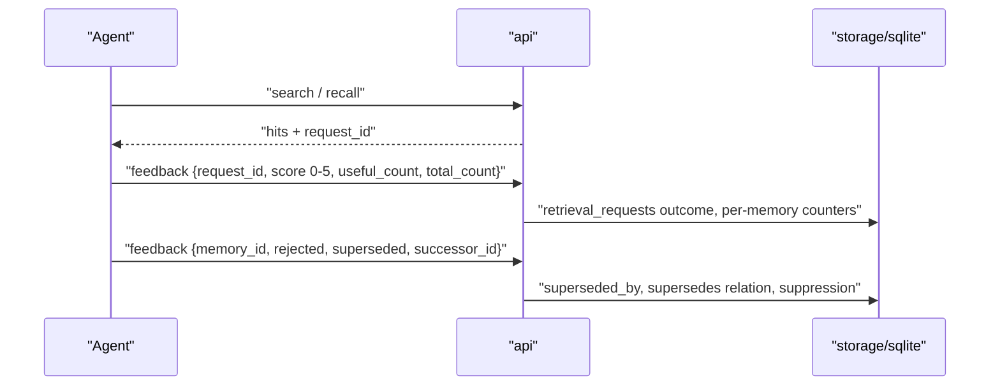
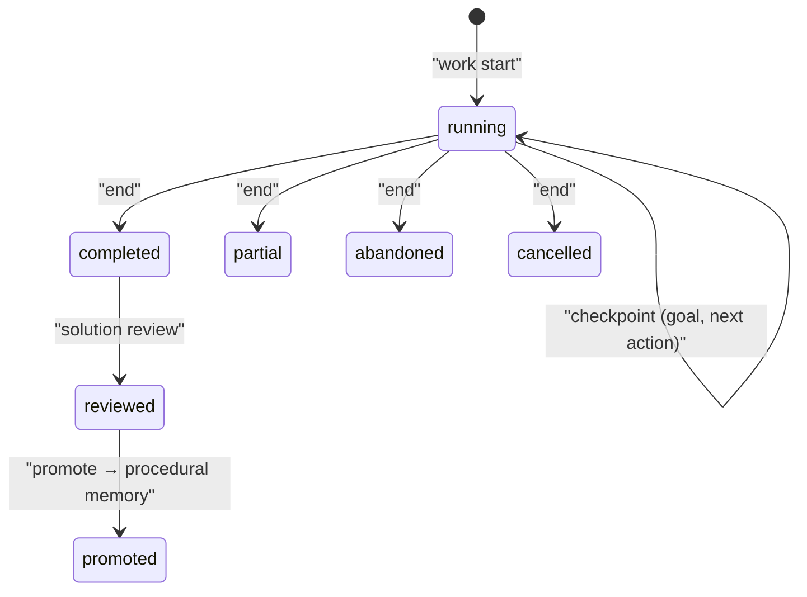
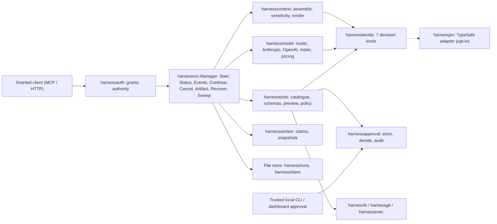
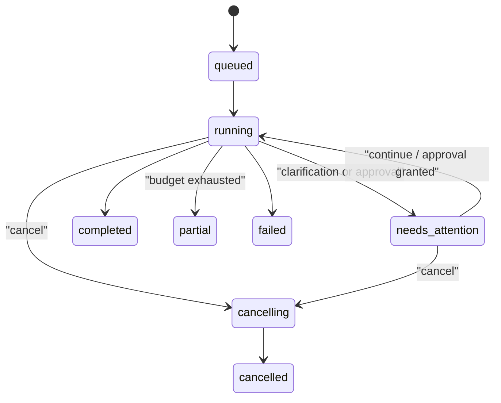

# Agent Memory — Detailed Architecture

> Companion to [high-level-architecture.md](high-level-architecture.md).
> Describes packages, data contracts, sequences, state machines, failure
> modes, and scaling characteristics. Statements are derived from the code at
> `main@8892b13`; items marked **(inferred)** are reasoned from structure and
> not verified line by line.

## 1. Repository map

| Path | Kind | Notes |
|---|---|---|
| `cmd/agent-memory`, `cmd/am` | Go entrypoints | Both call `cli.NewRootCommand()`; `am` only changes `Use` |
| `internal/` | ~50 Go packages, ~491 non-test files | All product logic |
| `tools/agent-memory/mcp-server` | Node | Single `server.js` MCP stdio adapter |
| `tools/agent-memory/dashboard` | React/Vite/Mantine | Built and embedded, served at `/dashboard/` and `/w/` |
| `tools/agent-memory/menubar` | Swift | macOS controller |
| `tools/graphrag-adapter` | Python (uv, Docker) | Offline GraphRAG indexing boundary |
| `sdk/go/agentmemory` | Go | Thin HTTP client |
| `.kiro/specs/*` | Specs | Requirements → design → tasks per feature |
| `benchmark/`, `evaluation/`, `test/`, `testdata/` | Quality | Retrieval benchmarks, eval suites, fixtures |

## 2. Package catalogue (by layer)

Sizes are non-test line counts, indicating where complexity concentrates.

### 2.1 Interface layer

| Package | LOC | Responsibility |
|---|---|---|
| `cli` | ~12.3k | cobra commands: `init`, `write`, `search`, `recall`, `feedback`, `work`, `session-end`, `study`, `serve`, `dashboard`, `tui`, `upgrade`, `install`, `listen`, `harness …`, `skill`, `distill`, `doctor`, `config`, `graph`, `reembed`, `reindex-terms`, `archive`, `consolidate`, `tuning`. Contains the HTTP transport used when the daemon is reachable (`transport.go`, `apiEnvelope`) |
| `api` | ~9.1k | HTTP mux, DTOs, `{ok,data,error}` envelope, handlers for memories, solutions, skills, library, notes, graph, observations, replay, scheduler, harness, client profiles, rights attestation, ops dashboard |
| `api/dashboard` | — | Embedded SPA assets and runtime config |
| `tui` | ~1.0k | Bubbletea keyboard workspace |
| `hooks` | ~0.2k | Client + policy for IDE hook calls into the service |
| `integration` | ~0.7k | IDE rule writers: Claude (incl. `listen`), Codex, default, project rules registry |
| `openaiapi` | ~0.4k | Bounded OpenAI Responses client for the explicit `openai_api` route |

### 2.2 Application layer

| Package | LOC | Responsibility |
|---|---|---|
| `application` | ~12.3k | Use-case services: `memory_service`, `recall` + graph enrichment, `session_end`, `note_service`/indexer, `solution_service` (episodes, steps, checkpoints, transitions, promotion, tool lessons), `solution_review`, `term_search`/`term_rebuild`/`term_status`, graph coordinator/projection/communities/review/local runner, full skill lifecycle (activation, approval, canary, custody, evaluation, policy, resolver, revision builder, recurrence) and the skill background orchestrator (router, worker, retry, reconciler, safety, security gate, budget, chaos, migration) |
| `workspace` | ~3.7k | Skill bundle store, materializer, import, distill, migration gate, predefined skills |
| `bootstrap` | ~1.2k | Install/init bootstrap steps |
| `advisor` | ~0.6k | Workspace memory-health scoring and recommendations |

### 2.3 Domain engines

| Package | LOC | Responsibility |
|---|---|---|
| `engine` | ~7.8k | Retrieval/scoring, write pipeline, lifecycle (decay, consolidation, deep consolidation, conflict, promotion/demotion), cold archive + summarizer, gap detection + reconstruction, recall assembly + gate, how-intent and how-recall, query cache, redaction, export, model version check, observation promotion |
| `retrieval` | ~1.0k | Graph-aware retrieval: local/global graph search, graph router, rerank, passages, context budget |
| `readingroom` | ~1.2k | Study/seminar workflows over library sources: evidence packets, synthesis, verifier, resume |
| `library`, `ingestion` | ~0.7k / ~1.3k | Library resources, citations, annotations, progress; document parsing/ingestion |
| `harness` | ~1.6k | Provider-neutral contracts (`Provider`, `DecisionProvider`, `ModelProvider`, `ToolProvider`, kinds `decision/model/tool`), session |
| `harnessrun` | ~3.0k | Run manager and state machine, loop, approval parking, file-backed store, recovery, sweep |
| `harnesscontext` | ~1.5k | Context assembly, sensitivity, rendering, run-source adapters |
| `harnessmodel` | ~1.3k | Anthropic and OpenAI providers, router, pricing, metering |
| `harnesstools` | ~3.6k | Tool catalogue (read, search, edit, command, git), schemas, preview/preimage, allow/ask/deny policy, control plane |
| `harnessdecide` | ~1.3k | Jev decision service: seven kinds, validation, health/rate limiting, typed outcomes |
| `harnessapproval`, `harnessauth` | ~1.1k / ~0.9k | Approval store/audit/decide; client authority grants |
| `harnessfs`, `harnessgit`, `harnessexec` | — | Root-confined FS, Git ops, command execution with fingerprints |
| `harnessworker`, `harnessjev`, `harnessproof` | — | Worker coordination (claims, snapshots), TypeSafe Jev adapter, proof records |
| `jev`, `jevconfig`, `modelroute` | — | Jev client/policy, host model catalogue, Claude subagent model routing |
| `localllm` | ~0.4k | Optional local LLM endpoint config (`local-llm.json`, 3 s default timeout) |

### 2.4 Domain model and infrastructure

| Package | Responsibility |
|---|---|
| `core` | `MemoryEntry`, `MemoryType`, `StorageTier`, `Relation`, `Outcome`, `SearchFilters`, `RecallOptions`, adaptive tuning, typed errors. Imports no internal package |
| `contracts` | Repository/port interfaces for graph, graph index/query/lifecycle/operations, skill orchestrator |
| `storage/sqlite` | ~15.4k LOC; `store.go`, `migrations.go`, vectors, terms, graph, notes, library, solutions, skills, scheduler, audit, metrics |
| `storage/markdown` | Markdown tier adapter (atomic file writes) |
| `embeddings` | `Provider` interface, local ONNX MiniLM runtime (cgo/no-cgo builds), tokenizer, quantization, similarity |
| `observability` | Prometheus registry, structured logging, OpenTelemetry tracing |
| `config`, `validation`, `locator`, `clientprofile`, `attestation`, `portable`, `replay`, `doctor`, `evaluation`, `testkit` | Supporting infrastructure |

## 3. Domain model

### 3.1 Memory types and half-lives

| Type | Half-life | Typical content | Default tier routing |
|---|---|---|---|
| episodic | 7 d | Transcripts, observations | document (large) / vector |
| semantic | 30 d | Facts, decisions | vector |
| procedural | 90 d | Checklists, workflows | vector |
| outcome | 60 d | What worked / failed | vector+graph |

Pinned or high-importance items route to the markdown tier.

### 3.2 Storage tiers

### 3.3 Memory entry contract (key fields)

| Group | Fields |
|---|---|
| Identity | `id`, `type`, `workspace`, `content`, up to 3 locators/keywords |
| Provenance | `source`, `confidence`, `created_at`, `updated_at` |
| Access | `last_accessed`, `access_count`, `useful/ignored/rejected/harmful` counts |
| Lifecycle | `decay_score`, `salience_score`, `suppression_score`, `suppression_until`, `storage_tier`, `pinned`, `promoted_at`, `demoted_at`, `importance` |
| Supersession | `superseded_by` |
| Graph | relations: `calls`, `depends_on`, `contains`, `contradicts`, `supersedes`, `led_to`, `derived_from` with weight 0–1 |

### 3.4 Persistence layout

Table families in each workspace DB (from `storage/sqlite`):

| Family | Tables (representative) |
|---|---|
| Core memory | `memories`, `memory_vectors`, `memory_terms`, `term_index_state`, `relations`, `memory_tombstones`, `reconstruction_lineage`, `tier_transitions` |
| Sessions and observations | `sessions`, `observations`, `memory_observation_provenance`, `replay_import_checkpoints` |
| Retrieval feedback | `retrieval_requests`, `solution_retrieval_feedback` |
| Solution paths | `solution_episodes`, `solution_steps`, `solution_summaries`, `solution_working_state`, `solution_promotions`, `solution_tool_events`, `solution_tool_lessons`, reviews/requests |
| Skills | `skills`, `skill_revisions`, `skill_candidates`, `skill_approvals`, `skill_activations`, `skill_evaluation_*`, `skill_executions`, `skill_policy_decisions`, `skill_legal_holds` |
| Skill orchestrator | `skill_orchestrator_jobs`, `_job_attempts`, `_workflows`, `_leader_leases`, `_budget_accounts`, `_budget_reservations`, `_events`, `_safety_signals`, `_reconciliation_cursors` |
| Knowledge graph | `graph_entities`, `graph_edges`, versions, evidence, `graph_communities`, `graph_jobs`, `graph_revisions`, `graph_reviews`, `graph_change_journal`, `knowledge_edges` |
| Library / study | `libraries`, `library_resources`, `source_passages`, `source_citations`, `book_*`, `study_sessions`, `study_turns`, `reading_progress`, `structural_nodes` |
| Notes | `notes`, `note_revisions`, `note_links`, `note_memory_chunks` |
| Operations | `scheduler_run_history`, `scheduler_workspace_state`, `audit_events`, `llm_usage_metrics`, `token_metrics`, `benchmark_runs`, `source_attestations`, `schema_migrations` |

Migrations are applied by `migrations.go` and tracked in `schema_migrations`;
DDL uses `IF NOT EXISTS`, so migration is idempotent on re-init/upgrade.

## 4. Interfaces

### 4.1 HTTP API (`127.0.0.1:3211`)

All JSON responses use the envelope `{ ok, data, error: { code, message } }`.
Workspace is selected per request (`workspace` field or query parameter).

| Group | Routes |
|---|---|
| Health/ops | `/health` (reports `service_mode: multi_workspace`), `/metrics`, `/ops/dashboard`, `/api/v1/capabilities`, `/api/v1/stats`, `/api/v1/audit`, `/api/v1/llm-usage` |
| Memories | `/api/v1/memories/{write,search,recall,recall/preview,feedback,pin,delete,recent,reconstruct,export,import,session-end}` |
| Feedback | `/api/v1/feedback`, `/api/v1/feedback/stats`, `/api/v1/requests/feedback` |
| Solutions | `/api/v1/solutions/{start,steps,checkpoint,transition,handoff,state,recall,review,promote,activity,tool-events,tool-lessons/derive,tool-lessons/promote}` |
| Skills | `/api/v1/skills`, `/inspect`, `/lifecycle`, `/lifecycle/list`, `/orchestration/{status,control}` |
| Graph | `/api/v1/graph`, `/api/v1/graph-index/{status,readiness,operations,explorer,review,feedback}`, `/api/v1/visualizations/*` |
| Library | `/api/v1/library/{imports,jobs,query,structure,wiki,memory-review,seminars/*,local-llm*}` |
| Notes | `/api/v1/notes/*` (CRUD, revisions, trash/restore, backlinks, index retry) |
| Sessions/observe | `/api/v1/sessions`, `/sessions/end`, `/observe`, `/observations`, `/observations/promote`, `/replay/*` |
| Projects | `/api/v1/projects/{init,list,rename,delete,study}` |
| Scheduler | `/api/v1/scheduler/{status,run,history}` |
| Harness | `/api/v1/harness/{capabilities,readiness,runs,runs/<id>…,approvals,admin,decide}` |
| Client/rights | `/api/v1/client-profiles[/<id>]`, `/api/v1/rights-attestation/{status,accept}`, `/api/v1/migrations/portable-export` |

### 4.2 MCP tools (Node adapter)

| Family | Tools |
|---|---|
| Memory | `memory_write`, `memory_search`, `memory_recall`, `memory_feedback`, `memory_session_end`, `memory_sessions`, `memory_health` |
| Solution | `solution_start`, `solution_step`, `solution_checkpoint`, `solution_transition`, `solution_handoff`, `solution_state`, `solution_recall`, `solution_promote`, `solution_tool_event`, `solution_tool_lesson_derive`, `solution_tool_lesson_promote` |
| Skill | `skill_list`, `skill_inspect`, `skill_resolve`, `skill_propose`, `skill_review`, `skill_acknowledge`, `skill_complete`, `skill_orchestration_status`, `skill_orchestration_control` |
| Harness | `harness_capabilities`, `harness_readiness`, `harness_start`, `harness_status`, `harness_events`, `harness_continue`, `harness_artifact`, `harness_cancel`, `harness_decide` |

Transport rule: HTTP only (`AGENT_MEMORY_URL`, default
`http://127.0.0.1:3211`). Success results carry `_transport.mode=http`;
failures are tool errors prefixed `transport=http degraded=true`. MCP
`harness_continue` can answer clarifications but **cannot approve** actions.

### 4.3 CLI transport

`cli.resolveRuntime` resolves workspace → DB path → model dir → API URL.
Commands prefer the warm daemon over HTTP; commands that are intrinsically
local (install, upgrade, init, doctor, migrations) operate on files directly
**(inferred from `transport.go` and command layout)**.

## 5. Core sequences

### 5.1 Write

Failure modes: invalid input → `ValidationError`; embedding failure →
`EmbeddingError` with no partial row (transactional); unknown workspace →
rejected without creating a DB.

### 5.2 Search and recall

Mode weights (from `engine/doc.go`): `search` semantic 0.55 / recency 0.20;
`recall` semantic 0.45 / recency 0.25 / decay 0.10; `relate` graph-focused;
`outcomes` outcome-heavy. Weights are overridable per workspace/mode via
adaptive policy (`AGENT_MEMORY_ADAPTIVE_POLICY_*`).

Invariant: a Bloom "maybe" is never a match; it always continues to canonical
term lookup. A Bloom "no" may skip SQLite.

### 5.3 Feedback loop

### 5.4 Lifecycle (scheduler)

The daemon's scheduler tracks per-workspace state (`memory_count`,
`hygiene_overdue`, `eligible_daily`, `run_in_progress`) and records runs
(`trigger`, `result`) in `scheduler_run_history`. A run executes:

1. **Decay** — `exp(-ln2 · age / halfLife)` with boosts for access, pins,
   successful outcomes.
2. **Consolidation** — cluster similar episodic memories into semantic facts
   with `derived_from` edges; deep consolidation mines repeated failures and
   procedures.
3. **Conflict** — detect contradictions; loser marked superseded with a
   `contradicts` edge.
4. **Promotion/demotion** — move between markdown and vector tiers (pins
   block demotion); `tier_transitions` records moves.
5. **Cold archive** — evict to tombstones with content hash; summarizer keeps
   a compact trace.
6. **Gap detection / reconstruction** — rebuild from tombstones, guarded by
   `reconstruction_lineage` against loops.

### 5.5 Solution episodes → procedural memory

Tool events can be distilled into tool lessons and promoted separately.
Episodes store safe summaries only; private reasoning is never persisted.

### 5.6 Skill lifecycle (summary)

Candidates (from episodes, distill, import) → revision builder → safety and
security gates → evaluation suite → approval → canary → activation →
recurrence checks → rollback/tombstone with legal holds. The background
orchestrator runs these as leased jobs with retries, budgets, reconciliation
cursors and chaos tests.

## 6. Jev harness

### 6.1 Components

### 6.2 Run state machine

Mutations (`Continue`, `Cancel`) require an idempotency key and the expected
generation. `Recover` reloads valid checkpoints after restart; corrupt files
are quarantined with a `.corrupt` extension. `Sweep` enforces retention of
transient run data. Budgets cap turns, wall time, tool calls, output, spend
and recursion; child runs inherit parent ceilings and cancellation.

### 6.3 Tool execution and approval

1. Model proposes a tool call → exact argument schema validation.
2. Mutations are **prepared** first (preview, preimage, file revisions).
3. Deterministic policy tier: `deny` (default), `allow` (e.g. read file),
   `ask`.
4. `ask` parks the run in `needs_attention/approval`; approval must come from a
   trusted local UI/CLI and is bound to run, generation, action digest, expiry
   and file revisions. Stale approval or symlink escape fails closed.
5. Execution is confined to the project root; command runs are fingerprinted.

### 6.4 Jev decisions

| Kind | Effect allowed | Egress |
|---|---|---|
| `visibility.v1` | Narrow chunk visibility (hide/short/long/full) | Opaque aliases |
| `model.v1` | Reorder eligible models | Opaque aliases |
| `tools.v1` | Narrow tools under schema budget | Opaque aliases |
| `cache.v1` | Order for prompt cache where measured | Opaque aliases |
| `command_risk.v1` | Raise risk only | Fixed vocabulary |
| `file_sensitivity.v1` | Raise sensitivity only (internal) | Not offered to direct clients |
| `subgoal_dedup.v1` | Deduplicate subgoals (internal) | Not offered to direct clients |

Every answer is validated against the closed candidate set (unknown,
duplicate, oversized, non-finite, low-confidence → ignored). Malformed, slow,
stale, denied, unavailable, cancelled and rate-limited responses are typed
outcomes with deterministic fallbacks; repeated failures trigger a cooldown.
`AGENT_MEMORY_HARNESS_JEV` enables kinds individually; direct `harness_decide`
calls have per-client/per-workspace budgets with shared health/rate limits.

### 6.5 Claude Code integration

- `/am listen` (`on`/`all`/`status`/`off`) toggles per-prompt recall context
  for a registered root; workspace root and cwd must match; never blocks a
  prompt.
- `listen all` additionally enables Jev advisory after credential and live
  probe checks.
- A managed `PreToolUse` hook on the `Agent` tool may replace only its `model`
  field with a validated Jev choice from a user-owned host catalogue.

## 7. Non-functional characteristics

| Concern | Mechanism |
|---|---|
| Latency | Warm daemon, open SQLite handles, query cache, warm embedding provider, Bloom pre-filter; MCP warm-call target < 250 ms |
| Throughput | Per-workspace DB parallelism; scheduler runs per workspace with `run_in_progress` guard |
| Scale limits | Vector search over SQLite BLOBs is linear-ish in candidate set size **(inferred)**; very large workspaces rely on term index, graph routing and caches |
| Reliability | Transactional writes, idempotent migrations, crash-recoverable harness runs, quarantined corrupt files |
| Security | Loopback bind, validation, grants, root confinement, approval binding, redaction, credentials outside DB/config |
| Privacy | Transient run chunks separate from durable memory; no raw hidden reasoning, secrets or unbounded tool output persisted |
| Observability | Prometheus, OTel traces, structured logs, audit events, LLM usage/token metrics, ops dashboard |

## 8. Failure modes

| Failure | Detection | Behaviour |
|---|---|---|
| Daemon down | MCP/hook HTTP error | MCP returns `transport=http degraded=true`; listen hook adds no context and does not block |
| Legacy per-workspace daemon on 3211 | `/health` lacks `service_mode: multi_workspace` | `doctor` guidance; stop legacy process |
| Embedding model missing | Provider init error | `EmbeddingError`; exact-term search still works without embeddings |
| Model version change | `model_version_check` | `reembed` command to rebuild vectors |
| Bloom snapshot stale/corrupt | `term_status` | Fall back to canonical term lookup; `reindex-terms` rebuilds |
| Jev slow/malformed/unavailable | Typed outcome | Deterministic fallback, cooldown; never blocks a run |
| Harness restart mid-run | `Recover` | Resume from last valid checkpoint |
| Stale approval / file changed | Revision + digest check | Fail closed; re-prepare required |
| GraphRAG job fails | `graph_jobs` status, readiness API | Previous active revision stays live; repair queue |

## 9. Extension points

- `embeddings.Provider` for new embedding backends.
- `internal/plugin` types: embedding, storage, lifecycle hooks, middleware,
  extensions.
- `harness.DecisionProvider` / `ModelProvider` / `ToolProvider` for new
  providers (registration rejects duplicates; missing provider is an explicit
  unavailable state).
- `contracts.*Repository` interfaces for alternative graph/skill stores.
- `integration` registry for new IDE rule writers.

## 10. Improvement backlog (architectural)

| Item | Rationale | Risk if ignored |
|---|---|---|
| Split `storage/sqlite/store.go` (~78 KB) and `skill_lifecycle.go`/`skill_orchestrator.go` (~57 KB each) by aggregate | Smaller review surface, clearer ownership | Regressions in unrelated features |
| Split `workspace/manager.go` (~68 KB) | Same | Same |
| Extract a composition root shared by `cli` and `api` | Both wire nearly every package | Wiring drift between CLI and daemon |
| Optional ANN index for large workspaces | Bound semantic search latency | Recall latency grows with corpus |
| Formal p50/p95 gates for MCP and recall | Owned by roadmap Task 6.4 | Silent performance regressions |
