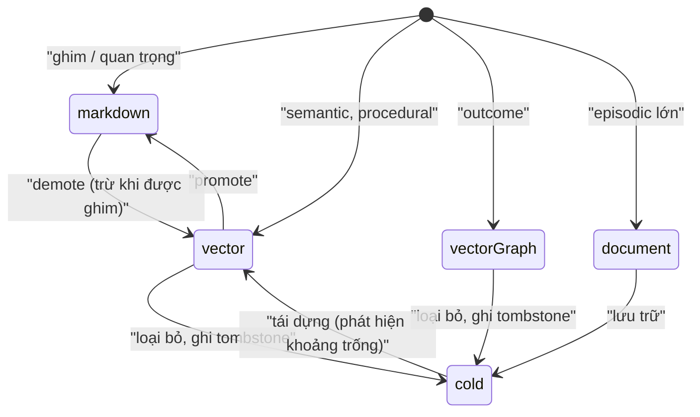
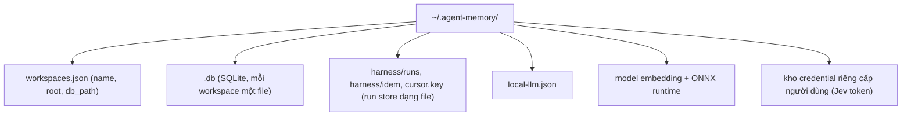
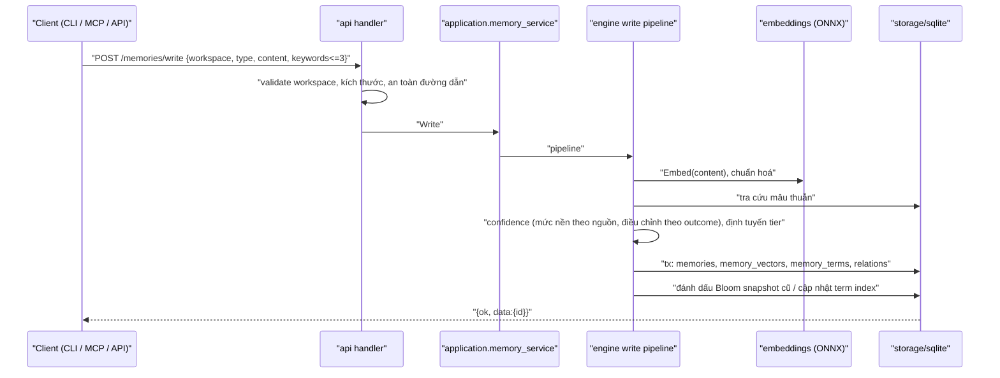
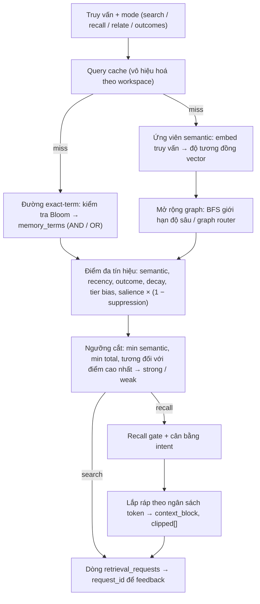
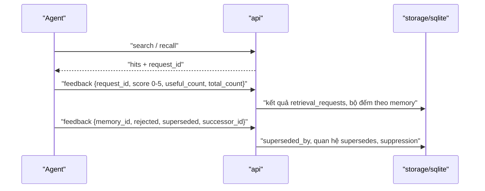
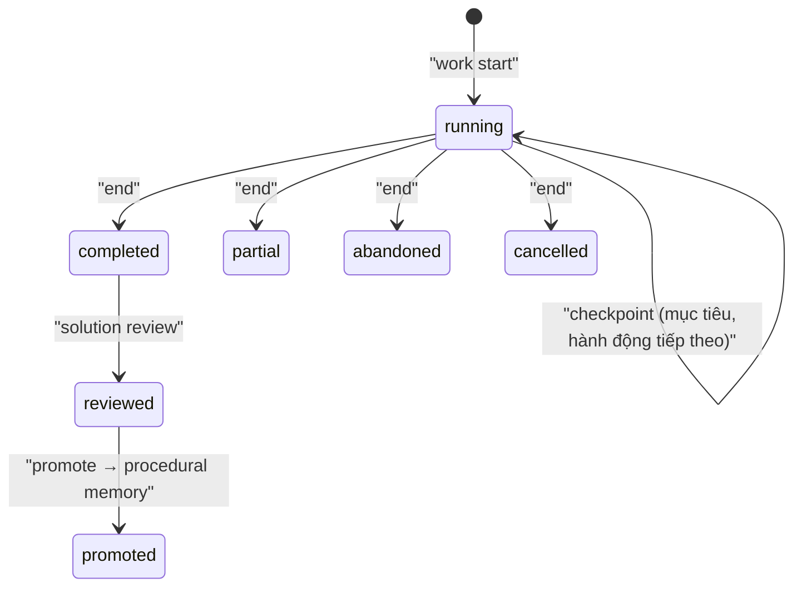
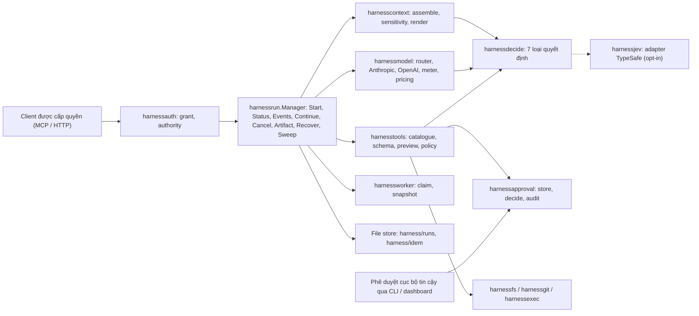
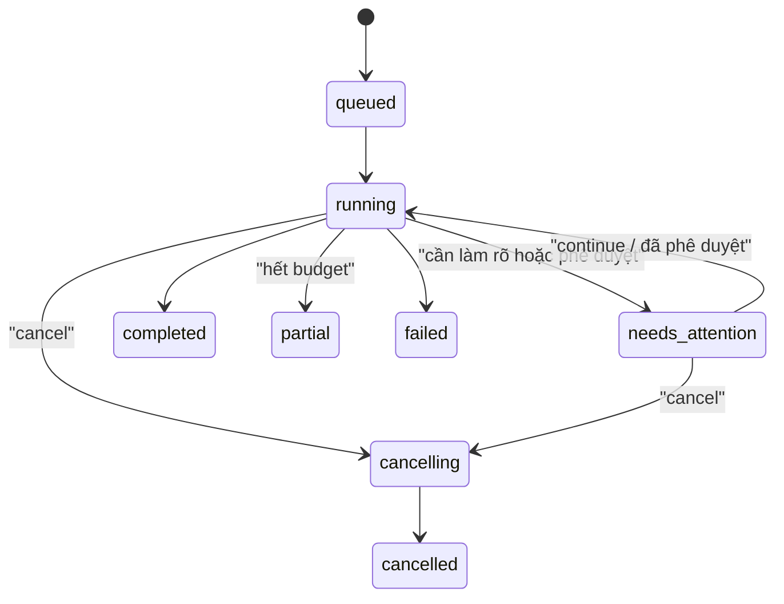

# Agent Memory — Kiến trúc chi tiết (Detail-Level)

> Tài liệu đi kèm [high-level-architecture.vi.md](high-level-architecture.vi.md).
> Mô tả package, hợp đồng dữ liệu, sequence, state machine, chế độ lỗi và đặc
> tính mở rộng. Các nhận định được rút ra từ code tại `main@8892b13`; mục đánh
> dấu **(suy luận)** được suy ra từ cấu trúc, chưa kiểm chứng từng dòng.
>
> Bản gốc tiếng Anh: [detailed-architecture.md](detailed-architecture.md).

## 1. Bản đồ repository

| Đường dẫn | Loại | Ghi chú |
|---|---|---|
| `cmd/agent-memory`, `cmd/am` | Entrypoint Go | Cả hai gọi `cli.NewRootCommand()`; `am` chỉ đổi `Use` |
| `internal/` | ~50 package Go, ~491 file không phải test | Toàn bộ logic sản phẩm |
| `tools/agent-memory/mcp-server` | Node | Một file `server.js` làm MCP stdio adapter |
| `tools/agent-memory/dashboard` | React/Vite/Mantine | Build và nhúng, phục vụ tại `/dashboard/` và `/w/` |
| `tools/agent-memory/menubar` | Swift | Bộ điều khiển macOS |
| `tools/graphrag-adapter` | Python (uv, Docker) | Ranh giới index GraphRAG offline |
| `sdk/go/agentmemory` | Go | HTTP client mỏng |
| `.kiro/specs/*` | Spec | Requirements → design → tasks cho từng tính năng |
| `benchmark/`, `evaluation/`, `test/`, `testdata/` | Chất lượng | Benchmark truy xuất, bộ eval, fixture |

## 2. Danh mục package (theo tầng)

Số dòng là LOC không tính test, cho thấy độ phức tạp tập trung ở đâu.

### 2.1 Tầng giao tiếp

| Package | LOC | Trách nhiệm |
|---|---|---|
| `cli` | ~12.3k | Lệnh cobra: `init`, `write`, `search`, `recall`, `feedback`, `work`, `session-end`, `study`, `serve`, `dashboard`, `tui`, `upgrade`, `install`, `listen`, `harness …`, `skill`, `distill`, `doctor`, `config`, `graph`, `reembed`, `reindex-terms`, `archive`, `consolidate`, `tuning`. Chứa HTTP transport dùng khi daemon sẵn sàng (`transport.go`, `apiEnvelope`) |
| `api` | ~9.1k | HTTP mux, DTO, envelope `{ok,data,error}`, handler cho memories, solutions, skills, library, notes, graph, observations, replay, scheduler, harness, client profile, rights attestation, ops dashboard |
| `api/dashboard` | — | Asset SPA nhúng và cấu hình runtime |
| `tui` | ~1.0k | Không gian làm việc bàn phím bằng Bubbletea |
| `hooks` | ~0.2k | Client + policy cho lời gọi hook từ IDE vào service |
| `integration` | ~0.7k | Bộ ghi rule IDE: Claude (gồm `listen`), Codex, mặc định, registry project rules |
| `openaiapi` | ~0.4k | Client OpenAI Responses có giới hạn cho route `openai_api` tường minh |

### 2.2 Tầng ứng dụng

| Package | LOC | Trách nhiệm |
|---|---|---|
| `application` | ~12.3k | Service theo use-case: `memory_service`, `recall` + làm giàu graph, `session_end`, `note_service`/indexer, `solution_service` (episode, step, checkpoint, transition, promote, tool lesson), `solution_review`, `term_search`/`term_rebuild`/`term_status`, graph coordinator/projection/communities/review/local runner, toàn bộ vòng đời skill (activation, approval, canary, custody, evaluation, policy, resolver, revision builder, recurrence) và skill background orchestrator (router, worker, retry, reconciler, safety, security gate, budget, chaos, migration) |
| `workspace` | ~3.7k | Skill bundle store, materializer, import, distill, migration gate, predefined skills |
| `bootstrap` | ~1.2k | Các bước bootstrap khi install/init |
| `advisor` | ~0.6k | Chấm điểm sức khoẻ bộ nhớ workspace và đưa khuyến nghị |

### 2.3 Engine nghiệp vụ

| Package | LOC | Trách nhiệm |
|---|---|---|
| `engine` | ~7.8k | Truy xuất/chấm điểm, write pipeline, lifecycle (decay, consolidation, deep consolidation, conflict, promote/demote), cold archive + summarizer, phát hiện khoảng trống + tái dựng, recall assembly + gate, how-intent và how-recall, query cache, redaction, export, kiểm tra phiên bản model, promote observation |
| `retrieval` | ~1.0k | Truy xuất theo graph: tìm kiếm graph local/global, graph router, rerank, passage, context budget |
| `readingroom` | ~1.2k | Luồng study/seminar trên nguồn library: evidence packet, tổng hợp, verifier, resume |
| `library`, `ingestion` | ~0.7k / ~1.3k | Tài nguyên library, trích dẫn, chú thích, tiến độ; parse/ingest tài liệu |
| `harness` | ~1.6k | Hợp đồng trung lập với provider (`Provider`, `DecisionProvider`, `ModelProvider`, `ToolProvider`, loại `decision/model/tool`), session |
| `harnessrun` | ~3.0k | Run manager và state machine, vòng lặp, tạm dừng chờ phê duyệt, store dạng file, khôi phục, sweep |
| `harnesscontext` | ~1.5k | Lắp ráp ngữ cảnh, độ nhạy cảm, render, adapter nguồn run |
| `harnessmodel` | ~1.3k | Provider Anthropic và OpenAI, router, bảng giá, đo lường |
| `harnesstools` | ~3.6k | Danh mục tool (read, search, edit, command, git), schema, preview/preimage, policy allow/ask/deny, control plane |
| `harnessdecide` | ~1.3k | Dịch vụ quyết định Jev: bảy loại, validate, health/rate limit, kết quả có kiểu |
| `harnessapproval`, `harnessauth` | ~1.1k / ~0.9k | Store/audit/quyết định phê duyệt; cấp quyền cho client |
| `harnessfs`, `harnessgit`, `harnessexec` | — | FS giới hạn trong root, thao tác Git, thực thi lệnh có fingerprint |
| `harnessworker`, `harnessjev`, `harnessproof` | — | Điều phối worker (claim, snapshot), adapter TypeSafe Jev, bản ghi proof |
| `jev`, `jevconfig`, `modelroute` | — | Client/policy Jev, catalogue model theo host, định tuyến model cho subagent Claude |
| `localllm` | ~0.4k | Cấu hình endpoint LLM cục bộ tuỳ chọn (`local-llm.json`, timeout mặc định 3 s) |

### 2.4 Mô hình miền và hạ tầng

| Package | Trách nhiệm |
|---|---|
| `core` | `MemoryEntry`, `MemoryType`, `StorageTier`, `Relation`, `Outcome`, `SearchFilters`, `RecallOptions`, adaptive tuning, lỗi có kiểu. Không import package nội bộ nào |
| `contracts` | Interface repository/port cho graph, graph index/query/lifecycle/operations, skill orchestrator |
| `storage/sqlite` | ~15.4k LOC; `store.go`, `migrations.go`, vectors, terms, graph, notes, library, solutions, skills, scheduler, audit, metrics |
| `storage/markdown` | Adapter Markdown tier (ghi file nguyên tử) |
| `embeddings` | Interface `Provider`, runtime ONNX MiniLM cục bộ (build cgo/no-cgo), tokenizer, quantization, similarity |
| `observability` | Prometheus registry, log có cấu trúc, tracing OpenTelemetry |
| `config`, `validation`, `locator`, `clientprofile`, `attestation`, `portable`, `replay`, `doctor`, `evaluation`, `testkit` | Hạ tầng hỗ trợ |

## 3. Mô hình miền

### 3.1 Loại bộ nhớ và chu kỳ bán rã

| Loại | Half-life | Nội dung điển hình | Tier mặc định |
|---|---|---|---|
| episodic | 7 ngày | Transcript, observation | document (lớn) / vector |
| semantic | 30 ngày | Fact, quyết định | vector |
| procedural | 90 ngày | Checklist, quy trình | vector |
| outcome | 60 ngày | Cái gì thành công / thất bại | vector+graph |

Mục được ghim hoặc có độ quan trọng cao được đưa vào markdown tier.

### 3.2 Các tier lưu trữ

### 3.3 Hợp đồng memory entry (trường chính)

| Nhóm | Trường |
|---|---|
| Định danh | `id`, `type`, `workspace`, `content`, tối đa 3 locator/keyword |
| Nguồn gốc | `source`, `confidence`, `created_at`, `updated_at` |
| Truy cập | `last_accessed`, `access_count`, bộ đếm `useful/ignored/rejected/harmful` |
| Vòng đời | `decay_score`, `salience_score`, `suppression_score`, `suppression_until`, `storage_tier`, `pinned`, `promoted_at`, `demoted_at`, `importance` |
| Thay thế | `superseded_by` |
| Graph | quan hệ: `calls`, `depends_on`, `contains`, `contradicts`, `supersedes`, `led_to`, `derived_from` với trọng số 0–1 |

### 3.4 Bố cục lưu trữ

Các họ bảng trong mỗi DB workspace (từ `storage/sqlite`):

| Họ bảng | Bảng (tiêu biểu) |
|---|---|
| Bộ nhớ lõi | `memories`, `memory_vectors`, `memory_terms`, `term_index_state`, `relations`, `memory_tombstones`, `reconstruction_lineage`, `tier_transitions` |
| Session và observation | `sessions`, `observations`, `memory_observation_provenance`, `replay_import_checkpoints` |
| Feedback truy xuất | `retrieval_requests`, `solution_retrieval_feedback` |
| Solution path | `solution_episodes`, `solution_steps`, `solution_summaries`, `solution_working_state`, `solution_promotions`, `solution_tool_events`, `solution_tool_lessons`, review/request |
| Skill | `skills`, `skill_revisions`, `skill_candidates`, `skill_approvals`, `skill_activations`, `skill_evaluation_*`, `skill_executions`, `skill_policy_decisions`, `skill_legal_holds` |
| Skill orchestrator | `skill_orchestrator_jobs`, `_job_attempts`, `_workflows`, `_leader_leases`, `_budget_accounts`, `_budget_reservations`, `_events`, `_safety_signals`, `_reconciliation_cursors` |
| Knowledge graph | `graph_entities`, `graph_edges`, version, evidence, `graph_communities`, `graph_jobs`, `graph_revisions`, `graph_reviews`, `graph_change_journal`, `knowledge_edges` |
| Library / study | `libraries`, `library_resources`, `source_passages`, `source_citations`, `book_*`, `study_sessions`, `study_turns`, `reading_progress`, `structural_nodes` |
| Notes | `notes`, `note_revisions`, `note_links`, `note_memory_chunks` |
| Vận hành | `scheduler_run_history`, `scheduler_workspace_state`, `audit_events`, `llm_usage_metrics`, `token_metrics`, `benchmark_runs`, `source_attestations`, `schema_migrations` |

Migration được áp dụng bởi `migrations.go` và theo dõi trong
`schema_migrations`; DDL dùng `IF NOT EXISTS` nên migration là idempotent khi
re-init/upgrade.

## 4. Giao diện

### 4.1 HTTP API (`127.0.0.1:3211`)

Mọi response JSON dùng envelope `{ ok, data, error: { code, message } }`.
Workspace được chọn theo từng request (trường `workspace` hoặc query
parameter).

| Nhóm | Route |
|---|---|
| Health/ops | `/health` (báo `service_mode: multi_workspace`), `/metrics`, `/ops/dashboard`, `/api/v1/capabilities`, `/api/v1/stats`, `/api/v1/audit`, `/api/v1/llm-usage` |
| Memories | `/api/v1/memories/{write,search,recall,recall/preview,feedback,pin,delete,recent,reconstruct,export,import,session-end}` |
| Feedback | `/api/v1/feedback`, `/api/v1/feedback/stats`, `/api/v1/requests/feedback` |
| Solutions | `/api/v1/solutions/{start,steps,checkpoint,transition,handoff,state,recall,review,promote,activity,tool-events,tool-lessons/derive,tool-lessons/promote}` |
| Skills | `/api/v1/skills`, `/inspect`, `/lifecycle`, `/lifecycle/list`, `/orchestration/{status,control}` |
| Graph | `/api/v1/graph`, `/api/v1/graph-index/{status,readiness,operations,explorer,review,feedback}`, `/api/v1/visualizations/*` |
| Library | `/api/v1/library/{imports,jobs,query,structure,wiki,memory-review,seminars/*,local-llm*}` |
| Notes | `/api/v1/notes/*` (CRUD, revision, trash/restore, backlink, index retry) |
| Sessions/observe | `/api/v1/sessions`, `/sessions/end`, `/observe`, `/observations`, `/observations/promote`, `/replay/*` |
| Projects | `/api/v1/projects/{init,list,rename,delete,study}` |
| Scheduler | `/api/v1/scheduler/{status,run,history}` |
| Harness | `/api/v1/harness/{capabilities,readiness,runs,runs/<id>…,approvals,admin,decide}` |
| Client/quyền | `/api/v1/client-profiles[/<id>]`, `/api/v1/rights-attestation/{status,accept}`, `/api/v1/migrations/portable-export` |

### 4.2 MCP tool (Node adapter)

| Họ | Tool |
|---|---|
| Memory | `memory_write`, `memory_search`, `memory_recall`, `memory_feedback`, `memory_session_end`, `memory_sessions`, `memory_health` |
| Solution | `solution_start`, `solution_step`, `solution_checkpoint`, `solution_transition`, `solution_handoff`, `solution_state`, `solution_recall`, `solution_promote`, `solution_tool_event`, `solution_tool_lesson_derive`, `solution_tool_lesson_promote` |
| Skill | `skill_list`, `skill_inspect`, `skill_resolve`, `skill_propose`, `skill_review`, `skill_acknowledge`, `skill_complete`, `skill_orchestration_status`, `skill_orchestration_control` |
| Harness | `harness_capabilities`, `harness_readiness`, `harness_start`, `harness_status`, `harness_events`, `harness_continue`, `harness_artifact`, `harness_cancel`, `harness_decide` |

Quy tắc transport: chỉ HTTP (`AGENT_MEMORY_URL`, mặc định
`http://127.0.0.1:3211`). Kết quả thành công mang `_transport.mode=http`;
lỗi là tool error có tiền tố `transport=http degraded=true`. MCP
`harness_continue` có thể trả lời câu hỏi làm rõ nhưng **không thể phê duyệt**
hành động.

### 4.3 Transport của CLI

`cli.resolveRuntime` phân giải workspace → đường dẫn DB → thư mục model → API
URL. Các lệnh ưu tiên daemon đang ấm qua HTTP; các lệnh vốn mang tính cục bộ
(install, upgrade, init, doctor, migration) thao tác trực tiếp trên file
**(suy luận từ `transport.go` và bố cục lệnh)**.

## 5. Các sequence lõi

### 5.1 Write

Chế độ lỗi: đầu vào không hợp lệ → `ValidationError`; lỗi embedding →
`EmbeddingError`, không ghi dở dang (có transaction); workspace không tồn tại
→ bị từ chối, không tạo DB.

### 5.2 Search và recall

Trọng số theo mode (từ `engine/doc.go`): `search` semantic 0.55 / recency
0.20; `recall` semantic 0.45 / recency 0.25 / decay 0.10; `relate` thiên về
graph; `outcomes` thiên về outcome. Trọng số có thể ghi đè theo
workspace/mode qua adaptive policy (`AGENT_MEMORY_ADAPTIVE_POLICY_*`).

Bất biến: Bloom trả "maybe" không bao giờ được coi là khớp; luôn đi tiếp tới
tra cứu term chuẩn. Bloom trả "no" có thể bỏ qua SQLite.

### 5.3 Vòng lặp feedback

### 5.4 Lifecycle (scheduler)

Scheduler của daemon theo dõi trạng thái từng workspace (`memory_count`,
`hygiene_overdue`, `eligible_daily`, `run_in_progress`) và ghi lại các lần
chạy (`trigger`, `result`) vào `scheduler_run_history`. Một lần chạy thực
hiện:

1. **Decay** — `exp(-ln2 · age / halfLife)` kèm tăng điểm cho truy cập, ghim,
   outcome thành công.
2. **Consolidation** — gom cụm các episodic tương tự thành fact semantic với
   cạnh `derived_from`; deep consolidation khai thác thất bại lặp lại và quy
   trình.
3. **Conflict** — phát hiện mâu thuẫn; bên thua bị đánh dấu superseded với
   cạnh `contradicts`.
4. **Promote/demote** — di chuyển giữa markdown và vector tier (ghim chặn
   demote); `tier_transitions` ghi lại các lần di chuyển.
5. **Cold archive** — loại bỏ vào tombstone kèm content hash; summarizer giữ
   lại vết rút gọn.
6. **Phát hiện khoảng trống / tái dựng** — dựng lại từ tombstone, có
   `reconstruction_lineage` chống vòng lặp.

### 5.5 Solution episode → procedural memory

Tool event có thể được chưng cất thành tool lesson và promote riêng. Episode
chỉ lưu tóm tắt an toàn; suy luận riêng tư không bao giờ được lưu.

### 5.6 Vòng đời skill (tóm tắt)

Ứng viên (từ episode, distill, import) → revision builder → cổng safety và
security → bộ evaluation → phê duyệt → canary → kích hoạt → kiểm tra định kỳ
→ rollback/tombstone với legal hold. Background orchestrator chạy các bước
này như job có lease, kèm retry, budget, reconciliation cursor và chaos test.

## 6. Jev harness

### 6.1 Thành phần

### 6.2 State machine của run

Thao tác thay đổi trạng thái (`Continue`, `Cancel`) yêu cầu idempotency key
và generation mong đợi. `Recover` nạp lại checkpoint hợp lệ sau khi khởi động
lại; file hỏng được cách ly với đuôi `.corrupt`. `Sweep` áp dụng thời hạn lưu
giữ dữ liệu run tạm thời. Budget giới hạn số lượt, thời gian thực, số lời gọi
tool, output, chi phí và độ sâu đệ quy; run con kế thừa giới hạn và việc huỷ
từ run cha.

### 6.3 Thực thi tool và phê duyệt

1. Model đề xuất lời gọi tool → validate chính xác theo schema tham số.
2. Thao tác thay đổi được **chuẩn bị** trước (preview, preimage, revision
   file).
3. Tier policy xác định: `deny` (mặc định), `allow` (vd. đọc file), `ask`.
4. `ask` đưa run vào `needs_attention/approval`; phê duyệt phải đến từ UI/CLI
   cục bộ tin cậy và gắn với run, generation, digest hành động, thời hạn và
   revision file. Phê duyệt cũ hoặc thoát qua symlink sẽ fail closed.
5. Việc thực thi bị giới hạn trong project root; lệnh chạy được gắn
   fingerprint.

### 6.4 Quyết định Jev

| Loại | Tác động được phép | Dữ liệu gửi ra |
|---|---|---|
| `visibility.v1` | Thu hẹp mức hiển thị chunk (hide/short/long/full) | Alias mờ |
| `model.v1` | Sắp xếp lại các model đủ điều kiện | Alias mờ |
| `tools.v1` | Thu hẹp tool trong ngân sách schema | Alias mờ |
| `cache.v1` | Sắp thứ tự cho prompt cache khi đã đo được | Alias mờ |
| `command_risk.v1` | Chỉ tăng mức rủi ro | Từ vựng cố định |
| `file_sensitivity.v1` | Chỉ tăng độ nhạy cảm (nội bộ) | Không mở cho client trực tiếp |
| `subgoal_dedup.v1` | Khử trùng lặp subgoal (nội bộ) | Không mở cho client trực tiếp |

Mọi câu trả lời được validate với tập ứng viên đóng (không rõ, trùng lặp, quá
kích thước, không hữu hạn, độ tin cậy thấp → bỏ qua). Phản hồi sai định dạng,
chậm, cũ, bị từ chối, không khả dụng, bị huỷ hoặc bị giới hạn tốc độ đều là
kết quả có kiểu với fallback xác định; lỗi lặp lại kích hoạt cooldown.
`AGENT_MEMORY_HARNESS_JEV` bật từng loại riêng; lời gọi `harness_decide` trực
tiếp có budget theo client/workspace, dùng chung giới hạn health/rate.

### 6.5 Tích hợp Claude Code

- `/am listen` (`on`/`all`/`status`/`off`) bật/tắt ngữ cảnh recall theo từng
  prompt cho một root đã đăng ký; workspace root và cwd phải khớp; không bao
  giờ chặn prompt.
- `listen all` bật thêm tư vấn Jev sau khi kiểm tra credential và probe trực
  tiếp.
- Hook `PreToolUse` được quản lý trên tool `Agent` chỉ có thể thay trường
  `model` bằng lựa chọn Jev đã validate từ catalogue host do người dùng sở
  hữu.

## 7. Đặc tính phi chức năng

| Mối quan tâm | Cơ chế |
|---|---|
| Độ trễ | Daemon ấm, handle SQLite mở sẵn, query cache, embedding provider ấm, lọc trước bằng Bloom; mục tiêu MCP warm-call < 250 ms |
| Thông lượng | Song song theo DB từng workspace; scheduler chạy theo workspace với cờ `run_in_progress` |
| Giới hạn quy mô | Tìm kiếm vector trên BLOB SQLite tăng gần tuyến tính theo kích thước tập ứng viên **(suy luận)**; workspace rất lớn dựa vào term index, graph routing và cache |
| Độ tin cậy | Ghi có transaction, migration idempotent, harness run khôi phục được sau crash, cách ly file hỏng |
| Bảo mật | Bind loopback, validation, grant, giới hạn root, ràng buộc phê duyệt, redaction, credential nằm ngoài DB/config |
| Quyền riêng tư | Chunk run tạm tách khỏi bộ nhớ bền vững; không lưu suy luận ẩn thô, secret hay output tool không giới hạn |
| Quan sát | Prometheus, OTel trace, log có cấu trúc, audit event, metric LLM/token, ops dashboard |

## 8. Chế độ lỗi

| Lỗi | Phát hiện | Hành vi |
|---|---|---|
| Daemon không chạy | Lỗi HTTP từ MCP/hook | MCP trả `transport=http degraded=true`; listen hook không thêm ngữ cảnh và không chặn |
| Daemon cũ theo workspace chiếm cổng 3211 | `/health` thiếu `service_mode: multi_workspace` | `doctor` hướng dẫn; dừng tiến trình cũ |
| Thiếu model embedding | Lỗi khởi tạo provider | `EmbeddingError`; exact-term search vẫn chạy không cần embedding |
| Đổi phiên bản model | `model_version_check` | Lệnh `reembed` dựng lại vector |
| Bloom snapshot cũ/hỏng | `term_status` | Quay về tra cứu term chuẩn; `reindex-terms` dựng lại |
| Jev chậm/sai định dạng/không khả dụng | Kết quả có kiểu | Fallback xác định, cooldown; không bao giờ chặn run |
| Harness khởi động lại giữa chừng | `Recover` | Tiếp tục từ checkpoint hợp lệ gần nhất |
| Phê duyệt cũ / file đã đổi | Kiểm tra revision + digest | Fail closed; phải chuẩn bị lại |
| Job GraphRAG thất bại | Trạng thái `graph_jobs`, API readiness | Revision đang active vẫn giữ nguyên; repair queue |

## 9. Điểm mở rộng

- `embeddings.Provider` cho backend embedding mới.
- Các loại trong `internal/plugin`: embedding, storage, lifecycle hook,
  middleware, extension.
- `harness.DecisionProvider` / `ModelProvider` / `ToolProvider` cho provider
  mới (đăng ký trùng bị từ chối; thiếu provider là trạng thái unavailable
  tường minh).
- Interface `contracts.*Repository` cho kho graph/skill thay thế.
- Registry `integration` cho bộ ghi rule IDE mới.

## 10. Backlog cải tiến kiến trúc

| Hạng mục | Lý do | Rủi ro nếu bỏ qua |
|---|---|---|
| Tách `storage/sqlite/store.go` (~78 KB) và `skill_lifecycle.go`/`skill_orchestrator.go` (~57 KB mỗi file) theo aggregate | Bề mặt review nhỏ hơn, quyền sở hữu rõ ràng hơn | Lỗi hồi quy lan sang tính năng không liên quan |
| Tách `workspace/manager.go` (~68 KB) | Như trên | Như trên |
| Tách một composition root dùng chung cho `cli` và `api` | Cả hai đều nối gần như mọi package | Lệch wiring giữa CLI và daemon |
| Index ANN tuỳ chọn cho workspace lớn | Giới hạn độ trễ tìm kiếm semantic | Độ trễ recall tăng theo kích thước dữ liệu |
| Cổng p50/p95 chính thức cho MCP và recall | Thuộc roadmap Task 6.4 | Hiệu năng suy giảm âm thầm |
