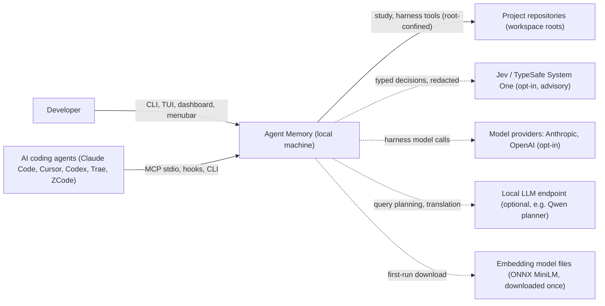
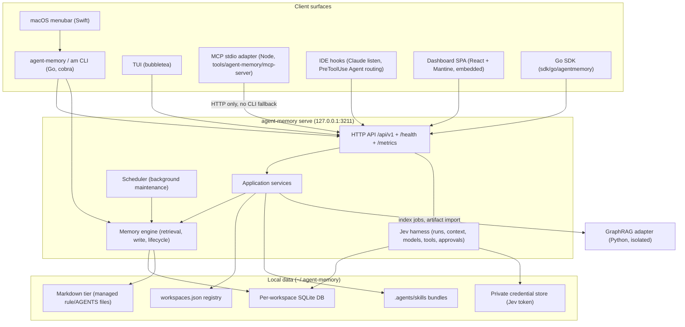
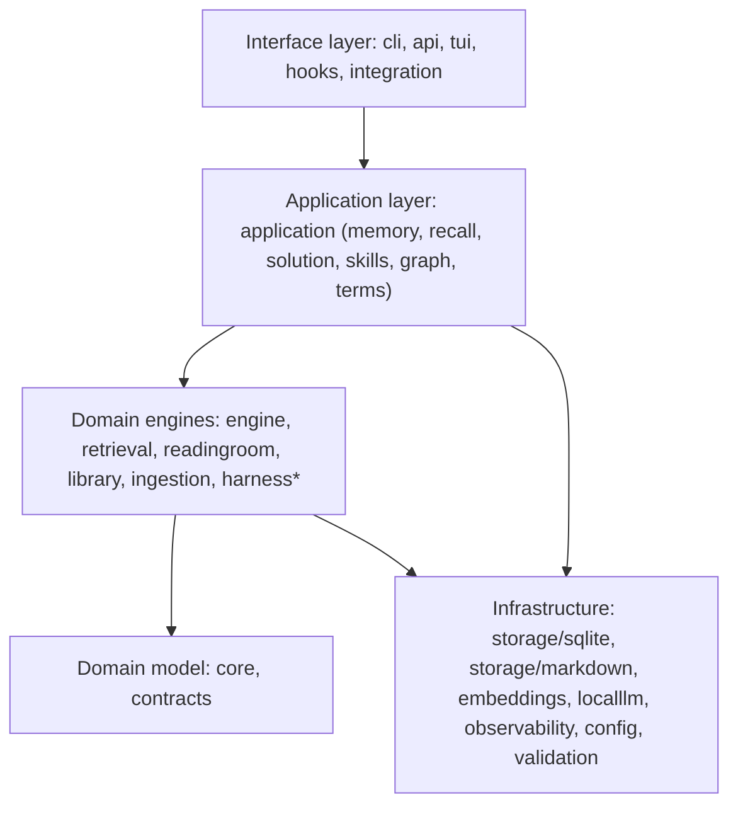

# Agent Memory — High-Level Architecture

> Scope: system context, containers, major runtime flows and cross-cutting
> concerns of the `agent-memory` repository as of `main@8892b13`
> (2026-10-18). Component internals live in
> [detailed-architecture.md](detailed-architecture.md).
>
> Sources inspected: `cmd/`, `internal/**`, `tools/**`, `sdk/go`,
> `README.md`, `docs/multi-workspace-daemon.md`,
> `docs/mcp-transport-decision.md`, `.kiro/specs/jev-harness/requirements.md`.

## 1. Purpose

Agent Memory is a **local-first, persistent memory layer and bounded coding
harness for AI coding agents** (Claude Code, Cursor, Codex, Trae, ZCode, Cline,
custom). It:

1. Stores what an agent learned (facts, procedures, outcomes, transcripts) in a
   per-workspace SQLite database under `~/.agent-memory/`.
2. Returns ranked, explainable, token-budgeted context on demand (`search`,
   `recall`, `solution recall`).
3. Runs a lifecycle ("REM cycle") that decays, consolidates, resolves
   conflicts, archives and reconstructs memory over time.
4. Learns reusable **solution paths** and **skills** from bounded work
   episodes and promotes them through a reviewed lifecycle.
5. Hosts the **Jev harness**: a policy-gated local run engine (context
   assembly, model routing, tool execution with approvals) plus optional
   advisory decisions from a remote Jev/TypeSafe provider that can only narrow
   or add caution, never grant authority.

No hosted service is part of the system. All network egress (model providers,
Jev, embedding model downloads) is opt-in.

## 2. System context

Trust boundary: everything inside "Agent Memory" runs as the user on
loopback. Dotted arrows are optional egress, each behind its own explicit
opt-in and credential.

## 3. Containers

| Container | Tech | Responsibility |
|---|---|---|
| CLI `agent-memory` / `am` | Go, cobra (`cmd/`, `internal/cli`) | Install/upgrade, workspace init, memory and work-episode commands, harness admin/approvals, starting the daemon |
| Daemon `serve` | Go `net/http` (`internal/api`) | Single multi-workspace service on `127.0.0.1:3211`; lazily opens each registered DB; hosts dashboard, metrics, scheduler, harness |
| MCP adapter | Node (`tools/agent-memory/mcp-server/src/server.js`) | Exposes `memory_*`, `solution_*`, `skill_*`, `harness_*` tools; HTTP-only transport to the daemon |
| Dashboard | React 18 + Vite + Mantine (`tools/agent-memory/dashboard`) | Built to static assets embedded and served under `/dashboard/` |
| Menubar | Swift (`tools/agent-memory/menubar`) | Thin controller: start/stop dashboard, upgrade |
| GraphRAG adapter | Python, pinned `graphrag==3.1.2` (`tools/graphrag-adapter`) | Offline indexing only; Agent Memory owns validation, import, activation and retrieval |
| Storage | SQLite (+FTS5), Markdown files | Five logical tiers inside one DB per workspace plus managed Markdown |

## 4. Logical layering

Verified dependency facts (`go list`): `core` and `harness` import no other
internal package; `application` depends on `engine`, `retrieval`,
`storage/sqlite`, `contracts`; `api` and `cli` are the composition roots that
wire everything together.

## 5. Key runtime flows (summary)

| Flow | Entry | Path | Output |
|---|---|---|---|
| Write | `memory write`, MCP `memory_write`, `POST /api/v1/memories/write` | validate → embed → confidence → tier routing → transactional insert → locators/Bloom | memory ID |
| Search | `search`, `memory_search` | exact-term (Bloom pre-check) and/or semantic candidates → multi-signal score → cutoffs | ranked hits + `request_id` |
| Recall | `recall`, `memory_recall` | search + graph enrichment → intent balancing → token budget assembly | `context_block`, clipped list |
| Feedback | `feedback` | per-request and per-memory signals → suppression / supersession | adaptive ranking |
| Work episode | `work start/step/checkpoint/end`, `solution_*` | solution path store → review → promotion | reusable procedural memory |
| Lifecycle | scheduler in `serve` | decay → consolidation → conflict → promote/demote → cold archive | healthier store |
| Harness run | `harness_start` (granted client) | auth → context assembly → model loop → tool prepare → policy allow/ask/deny → approval → execute → checkpoint | run status, events, artifacts |
| Jev decision | `harness_decide`, in-run decisions | closed candidate set → provider → validate → raise-only merge | advisory value |

## 6. Cross-cutting concerns

- **Workspace isolation**: one SQLite file per workspace, selected by
  `--workspace` / `workspace` parameter against the registry. Unknown names
  are rejected and never create files.
- **Security**: loopback-only listener; input validation and path-traversal
  checks (`internal/validation`); harness client grants (`harnessauth`);
  approvals bound to run, generation, action digest, expiry and file revisions
  (`harnessapproval`); project-root confinement and symlink-escape checks
  (`harnessfs`); redaction before egress (`engine/redact.go`, Jev egress
  classes).
- **Fail-closed external advice**: Jev and model providers produce typed
  outcomes with deterministic fallbacks; a decision can only reorder, narrow,
  or raise caution.
- **Observability**: Prometheus `/metrics`, structured logs, OpenTelemetry
  tracing, LLM usage metrics, audit log, ops dashboard (`/ops/dashboard`).
- **Explainability**: per-signal score breakdowns, clipped-item reasons,
  retrieval feedback with `request_id`.
- **Portability**: portable export/import bundles (`internal/portable`,
  `api/portable-bundle-v2.md`).

## 7. Deployment topology

Single user machine. Installers (Homebrew tap, `install.go`, scripts) publish
`agent-memory` and `am`, optionally download the ONNX embedding runtime/model
and an optional local planner model, and write IDE rule files into each
initialized project. One background daemon per user serves all workspaces;
legacy one-port-per-workspace services are explicitly unsupported.

## 8. Architectural decisions and trade-offs

| Decision | Chosen | Alternatives | Trade-off |
|---|---|---|---|
| Storage engine | Embedded SQLite per workspace | Postgres, dedicated vector DB | Zero ops and strong isolation vs. no cross-workspace queries and single-writer limits |
| Retrieval | Hybrid semantic + exact terms + graph + rerank | Vector-only | Better precision and explainability vs. more tuning surface |
| Embeddings | Local ONNX MiniLM | Cloud embeddings | Private and offline vs. lower quality than large hosted models |
| Process model | One warm multi-workspace daemon | CLI subprocess per call, daemon per workspace | Warm caches and one URL vs. a long-lived process to manage |
| MCP transport | HTTP only, no silent CLI fallback | Fallback to CLI | Explicit degradation vs. hard dependency on daemon availability |
| Knowledge graph indexing | External pinned GraphRAG adapter | Vendored GraphRAG, in-process Go | Replaceable and sandboxed vs. Python toolchain dependency |
| Remote advice (Jev) | Advisory, raise-only, typed | Remote policy authority | Safety and auditability vs. limited remote leverage |

## 9. Known risks

- **Daemon single point of failure** for MCP/hooks; mitigated by
  `serve --status`, `doctor`, explicit `transport=http degraded=true` errors.
- **SQLite write contention** under concurrent harness workers and scheduler;
  mitigated by per-workspace DBs, transactional writes and locks/isolated
  branches for mutating workers.
- **Large composition roots** (`cli`, `api`, `workspace/manager.go` ≈ 68 KB,
  `storage/sqlite/store.go` ≈ 78 KB) raise change risk; candidates for
  decomposition.
- **Egress misconfiguration**; mitigated by per-kind egress classes,
  explicit opt-in, and credentials kept outside workspace config/DB.
