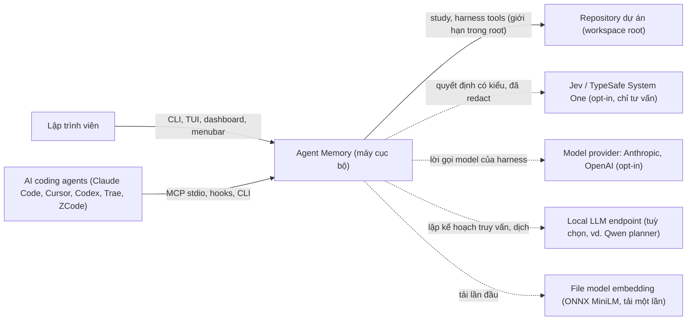
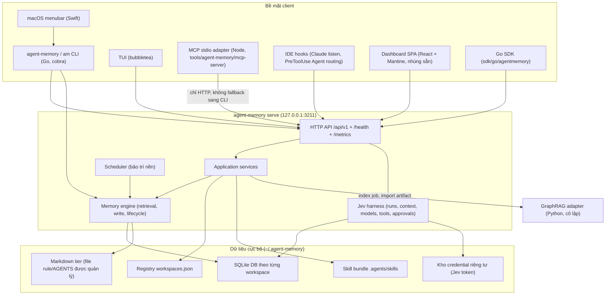
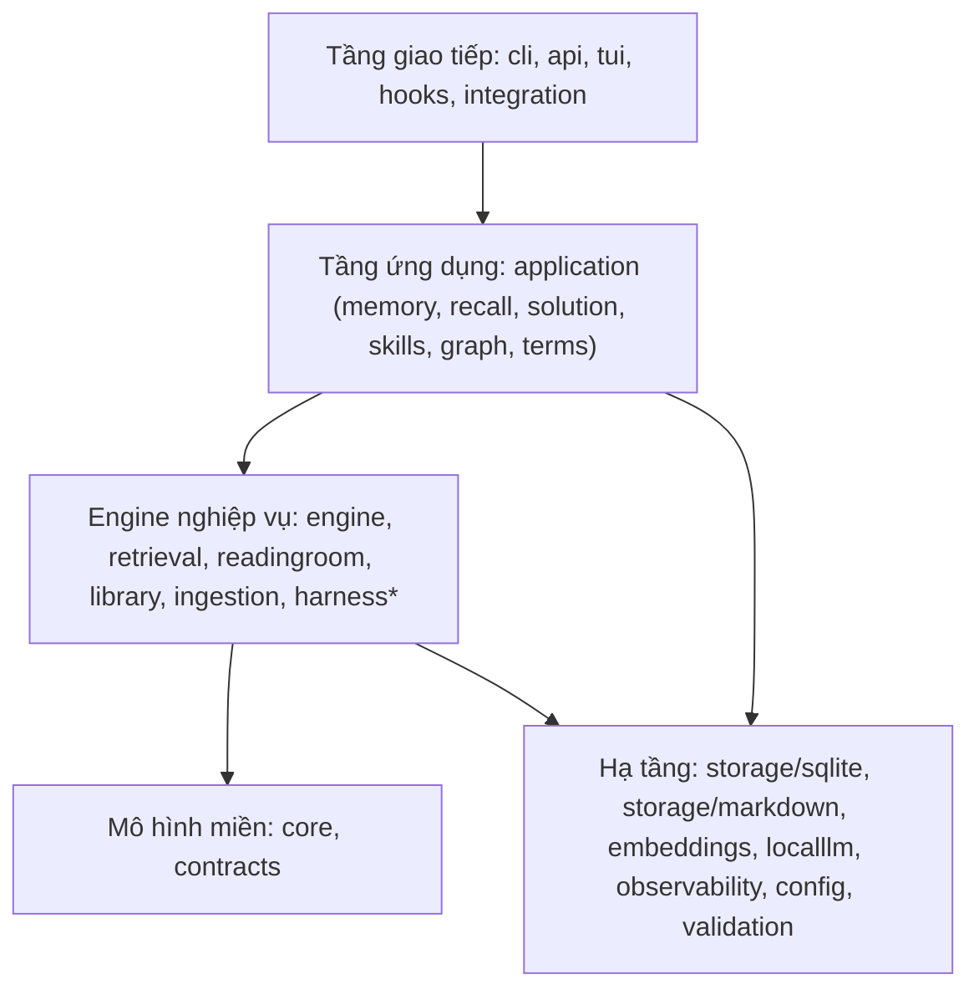

# Agent Memory — Kiến trúc tổng quan (High-Level)

> Phạm vi: bối cảnh hệ thống, các container, luồng runtime chính và các mối
> quan tâm xuyên suốt của repository `agent-memory` tại `main@8892b13`
> (2026-10-18). Chi tiết bên trong từng thành phần nằm ở
> [detailed-architecture.vi.md](detailed-architecture.vi.md).
>
> Bản gốc tiếng Anh: [high-level-architecture.md](high-level-architecture.md).
>
> Nguồn đã khảo sát: `cmd/`, `internal/**`, `tools/**`, `sdk/go`,
> `README.md`, `docs/multi-workspace-daemon.md`,
> `docs/mcp-transport-decision.md`, `.kiro/specs/jev-harness/requirements.md`.

## 1. Mục đích

Agent Memory là **lớp bộ nhớ bền vững, ưu tiên chạy cục bộ (local-first), kèm
một harness lập trình có giới hạn cho các AI coding agent** (Claude Code,
Cursor, Codex, Trae, ZCode, Cline, agent tuỳ biến). Hệ thống:

1. Lưu những gì agent đã học (fact, quy trình, kết quả, transcript) vào một
   database SQLite riêng cho mỗi workspace dưới `~/.agent-memory/`.
2. Trả về ngữ cảnh đã xếp hạng, giải thích được và giới hạn theo token khi
   được yêu cầu (`search`, `recall`, `solution recall`).
3. Chạy một vòng đời ("REM cycle") để làm phai (decay), hợp nhất
   (consolidate), giải quyết mâu thuẫn, lưu trữ lạnh và tái dựng bộ nhớ theo
   thời gian.
4. Học các **solution path** và **skill** tái sử dụng được từ các episode công
   việc có giới hạn, rồi đưa chúng qua một vòng đời có review để promote.
5. Chứa **Jev harness**: một engine chạy tác vụ cục bộ có kiểm soát bằng
   policy (lắp ráp ngữ cảnh, định tuyến model, thực thi tool có phê duyệt) và
   tuỳ chọn nhận quyết định tư vấn (advisory) từ nhà cung cấp Jev/TypeSafe từ
   xa — các quyết định này chỉ có thể thu hẹp hoặc tăng mức thận trọng, không
   bao giờ cấp quyền.

Không có dịch vụ hosted nào thuộc hệ thống. Mọi kết nối ra ngoài (model
provider, Jev, tải model embedding) đều phải bật tường minh (opt-in).

## 2. Bối cảnh hệ thống

Ranh giới tin cậy: mọi thứ bên trong "Agent Memory" chạy dưới quyền người
dùng trên loopback. Các mũi tên nét đứt là kết nối ra ngoài tuỳ chọn, mỗi kết
nối có opt-in và credential riêng.

## 3. Các container

| Container | Công nghệ | Trách nhiệm |
|---|---|---|
| CLI `agent-memory` / `am` | Go, cobra (`cmd/`, `internal/cli`) | Cài đặt/nâng cấp, init workspace, lệnh memory và work-episode, quản trị/phê duyệt harness, khởi động daemon |
| Daemon `serve` | Go `net/http` (`internal/api`) | Một service đa workspace duy nhất trên `127.0.0.1:3211`; mở lười (lazy) từng DB đã đăng ký; phục vụ dashboard, metrics, scheduler, harness |
| MCP adapter | Node (`tools/agent-memory/mcp-server/src/server.js`) | Cung cấp các tool `memory_*`, `solution_*`, `skill_*`, `harness_*`; transport chỉ qua HTTP tới daemon |
| Dashboard | React 18 + Vite + Mantine (`tools/agent-memory/dashboard`) | Build thành static asset nhúng vào binary, phục vụ tại `/dashboard/` |
| Menubar | Swift (`tools/agent-memory/menubar`) | Bộ điều khiển mỏng: bật/tắt dashboard, nâng cấp |
| GraphRAG adapter | Python, ghim `graphrag==3.1.2` (`tools/graphrag-adapter`) | Chỉ index offline; Agent Memory giữ quyền validate, import, kích hoạt và truy xuất |
| Storage | SQLite (+FTS5), file Markdown | Năm tier logic trong một DB mỗi workspace, cộng Markdown được quản lý |

## 4. Phân tầng logic

Sự thật về phụ thuộc đã kiểm chứng (`go list`): `core` và `harness` không
import package nội bộ nào khác; `application` phụ thuộc `engine`,
`retrieval`, `storage/sqlite`, `contracts`; `api` và `cli` là các
composition root nối mọi thứ lại với nhau.

## 5. Các luồng runtime chính (tóm tắt)

| Luồng | Điểm vào | Đường đi | Đầu ra |
|---|---|---|---|
| Write | `memory write`, MCP `memory_write`, `POST /api/v1/memories/write` | validate → embed → confidence → định tuyến tier → insert trong transaction → locator/Bloom | memory ID |
| Search | `search`, `memory_search` | exact-term (kiểm tra trước bằng Bloom) và/hoặc ứng viên semantic → chấm điểm đa tín hiệu → ngưỡng cắt | hit đã xếp hạng + `request_id` |
| Recall | `recall`, `memory_recall` | search + làm giàu bằng graph → cân bằng theo intent → lắp ráp theo ngân sách token | `context_block`, danh sách bị cắt (clipped) |
| Feedback | `feedback` | tín hiệu theo request và theo memory → suppression / supersession | xếp hạng thích nghi |
| Work episode | `work start/step/checkpoint/end`, `solution_*` | kho solution path → review → promote | procedural memory tái sử dụng |
| Lifecycle | scheduler trong `serve` | decay → consolidation → conflict → promote/demote → cold archive | kho dữ liệu khoẻ hơn |
| Harness run | `harness_start` (client được cấp quyền) | auth → lắp ráp ngữ cảnh → vòng lặp model → chuẩn bị tool → policy allow/ask/deny → phê duyệt → thực thi → checkpoint | trạng thái run, event, artifact |
| Jev decision | `harness_decide`, quyết định trong run | tập ứng viên đóng → provider → validate → gộp kiểu chỉ-tăng-thận-trọng | giá trị tư vấn |

## 6. Các mối quan tâm xuyên suốt

- **Cô lập workspace**: mỗi workspace một file SQLite, chọn bằng
  `--workspace` / tham số `workspace` đối chiếu với registry. Tên không tồn
  tại bị từ chối và không bao giờ tạo file.
- **Bảo mật**: chỉ lắng nghe trên loopback; kiểm tra đầu vào và path
  traversal (`internal/validation`); cấp quyền client cho harness
  (`harnessauth`); phê duyệt gắn với run, generation, digest hành động, thời
  hạn và revision file (`harnessapproval`); giới hạn trong project root và
  chặn thoát qua symlink (`harnessfs`); redact trước khi gửi ra ngoài
  (`engine/redact.go`, lớp egress của Jev).
- **Tư vấn bên ngoài kiểu fail-closed**: Jev và model provider trả về kết quả
  có kiểu với fallback xác định; một quyết định chỉ có thể sắp xếp lại, thu
  hẹp hoặc tăng mức thận trọng.
- **Quan sát (observability)**: Prometheus `/metrics`, log có cấu trúc,
  tracing OpenTelemetry, metric sử dụng LLM, audit log, ops dashboard
  (`/ops/dashboard`).
- **Khả năng giải thích**: phân rã điểm theo từng tín hiệu, lý do bị cắt,
  feedback truy xuất gắn `request_id`.
- **Tính di động**: export/import bundle di động (`internal/portable`,
  `api/portable-bundle-v2.md`).

## 7. Mô hình triển khai

Một máy người dùng duy nhất. Các bộ cài (Homebrew tap, `install.go`, script)
phát hành cả `agent-memory` và `am`, tuỳ chọn tải ONNX runtime/model embedding
và một model planner cục bộ, đồng thời ghi file rule IDE vào mỗi dự án đã
init. Một daemon nền cho mỗi người dùng phục vụ tất cả workspace; mô hình cũ
mỗi workspace một cổng được tuyên bố rõ là không còn hỗ trợ.

## 8. Quyết định kiến trúc và đánh đổi

| Quyết định | Đã chọn | Phương án khác | Đánh đổi |
|---|---|---|---|
| Storage engine | SQLite nhúng, mỗi workspace một DB | Postgres, vector DB chuyên dụng | Không cần vận hành, cô lập mạnh vs. không truy vấn chéo workspace, giới hạn single-writer |
| Retrieval | Lai: semantic + exact term + graph + rerank | Chỉ vector | Độ chính xác và khả năng giải thích tốt hơn vs. nhiều thứ phải tinh chỉnh hơn |
| Embeddings | ONNX MiniLM cục bộ | Embedding trên cloud | Riêng tư, chạy offline vs. chất lượng thấp hơn model hosted lớn |
| Mô hình tiến trình | Một daemon ấm đa workspace | Subprocess CLI mỗi lời gọi, daemon mỗi workspace | Cache ấm và một URL duy nhất vs. phải quản lý tiến trình chạy lâu |
| Transport MCP | Chỉ HTTP, không âm thầm fallback CLI | Fallback sang CLI | Suy giảm tường minh vs. phụ thuộc cứng vào daemon |
| Index knowledge graph | GraphRAG adapter bên ngoài, ghim phiên bản | Vendor GraphRAG, viết lại bằng Go | Thay thế được, cô lập vs. phụ thuộc toolchain Python |
| Tư vấn từ xa (Jev) | Chỉ tư vấn, chỉ-tăng, có kiểu | Jev làm policy authority | An toàn, kiểm toán được vs. hạn chế đòn bẩy từ xa |

## 9. Rủi ro đã biết

- **Daemon là điểm lỗi đơn** cho MCP/hooks; giảm thiểu bằng
  `serve --status`, `doctor`, lỗi tường minh `transport=http degraded=true`.
- **Tranh chấp ghi SQLite** khi nhiều harness worker và scheduler chạy đồng
  thời; giảm thiểu bằng DB riêng mỗi workspace, ghi trong transaction và
  lock/branch cô lập cho worker có ghi.
- **Composition root quá lớn** (`cli`, `api`, `workspace/manager.go` ≈ 68 KB,
  `storage/sqlite/store.go` ≈ 78 KB) làm tăng rủi ro khi thay đổi; là ứng viên
  để tách nhỏ.
- **Cấu hình egress sai**; giảm thiểu bằng lớp egress theo từng loại quyết
  định, opt-in tường minh, và credential nằm ngoài cấu hình workspace/DB.
