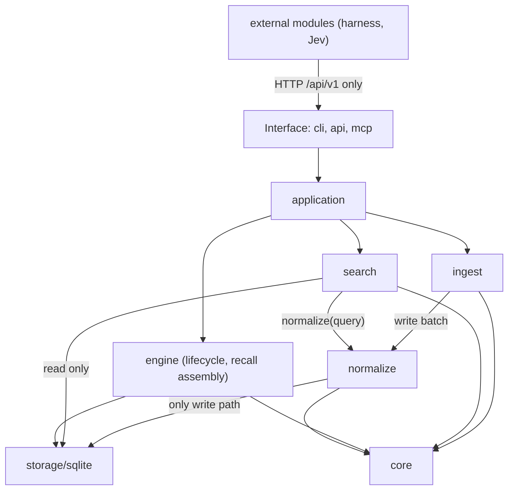
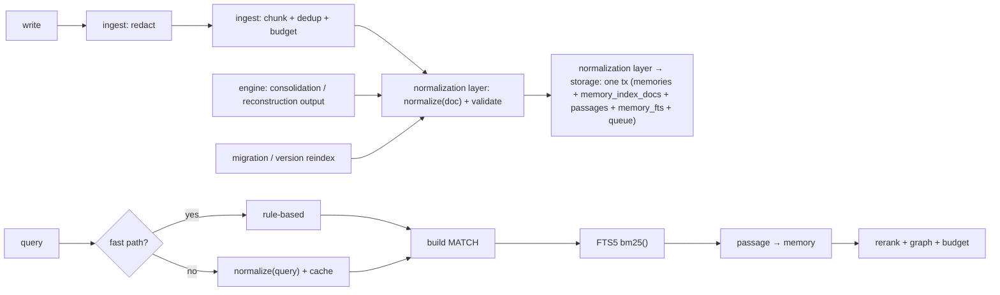
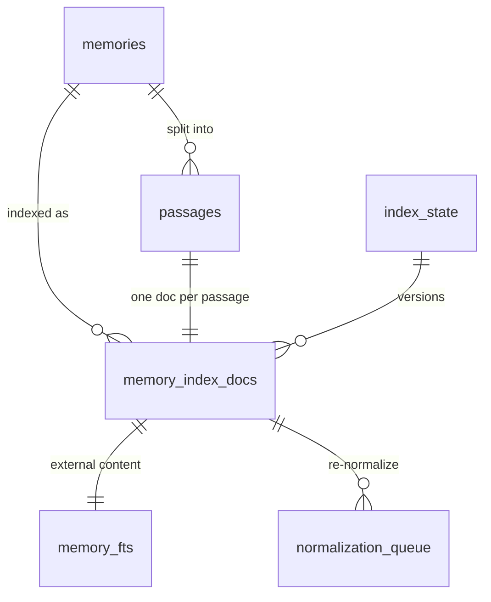

# Architecture Spine — agent-memory PR01

## Design Paradigm

Lõi phân tầng (interface → application → domain engines → infrastructure). Ingest và query là hai pipeline dạng pipes-and-filters dùng chung một Normalizer. Mọi năng lực ngoài lõi (harness, Jev) đi qua cổng extension, lõi không import chúng.

| Lớp | Package / thư mục |
|---|---|
| Interface | `internal/cli`, `internal/api`, `tools/agent-memory/mcp-server` |
| Application | `internal/application` |
| Pipelines | `internal/ingest` (mới: redact, chunker, dedup, LLM budget, job orchestration — **không phụ thuộc storage**), `internal/search` (mới: BM25 query builder, aggregation, rerank — chỉ đọc storage) |
| Normalization layer | `internal/normalize` (mới: tokenizer, rule-based, LLM adapter, validator, và **cổng ghi duy nhất** vào storage cho nội dung và chỉ mục) |
| Domain | `internal/core`, `internal/engine` (lifecycle, recall assembly) |
| Infrastructure | `internal/storage/sqlite` (FTS5, index tables) |

## Invariants & Rules



### AD-1 — BM25 là nguồn ứng viên duy nhất

- **Binds:** FR-1, FR-3, FR-6, `internal/search`, `internal/engine`
- **Prevents:** đường truy xuất song song (vector/term) quay lại và tạo điểm không so sánh được
- **Rule:** mọi truy xuất lấy ứng viên chỉ qua `search` trên chỉ mục FTS5. Điểm BM25 được chuẩn hoá về 0..1 trước khi trộn với tín hiệu khác. Không package nào ngoài `search` được tạo câu `MATCH`.

### AD-2 — Chỉ mục FTS5 với external content và pre-tokenize trong Go [ADOPTED]

- **Binds:** FR-2, FR-9, FR-10, `internal/storage/sqlite`, `internal/normalize`
- **Prevents:** tokenizer lúc index và lúc query khác nhau; văn bản bị nhân đôi
- **Rule:** cột FTS5 chỉ chứa chuỗi token đã được tokenizer Go tạo ra, nối bằng khoảng trắng. FTS5 dùng `unicode61` với `remove_diacritics 0`. Bảng FTS dùng `content=memory_index_docs`. Ghi memory và cập nhật FTS nằm trong cùng một transaction.

### AD-3 — Tập field cố định và trọng số cấu hình được

- **Binds:** FR-2, FR-4, FR-11
- **Prevents:** mỗi call site tự đặt trọng số
- **Rule:** đúng 6 field `identifiers`, `keywords`, `title`, `normalized_body`, `expansions`, `raw_body`, theo thứ tự này. Trọng số chỉ đọc từ `index_state.bm25_weights`. Thêm field mới phải có AD mới và tăng `index_generation`.

### AD-4 — Một Normalizer, một version cho cả doc và query

- **Binds:** FR-12, FR-13, FR-15, FR-16
- **Prevents:** lệch chuẩn hoá giữa index và query
- **Rule:** cả ingest và query gọi cùng interface `normalize` với `mode=doc|query`. Mọi doc và mọi entry trong query cache mang `normalizer_version`. Đổi version thì phải reindex nền; query cache khác version bị bỏ qua.

### AD-5 — Output normalizer là dữ liệu có schema, không phải lệnh

- **Binds:** FR-13, NFR-5, NFR-6
- **Prevents:** prompt injection từ nội dung memory ảnh hưởng hành vi hệ thống
- **Rule:** output được giải mã qua grammar/JSON schema cố định rồi qua validator (giới hạn độ dài, identifier phải có trong input, khử trùng lặp, sắp xếp ổn định). Output chỉ được ghi vào field chỉ mục; không bao giờ được thực thi, dùng làm policy hay ghi vào `memories.content`. Redaction chạy trước normalizer.

### AD-6 — LLM không bao giờ là điều kiện bắt buộc

- **Binds:** FR-14, FR-15, FR-16, FR-19
- **Prevents:** ghi hoặc tìm thất bại vì model chậm, thiếu hay lỗi
- **Rule:** mọi lời gọi LLM có deadline. Hết hạn hoặc lỗi thì dùng rule-based và gắn `normalization=fallback`. Doc fallback được đưa vào `normalization_queue`. Build `normalizer_rules` (pure Go) phải đạt đủ chức năng.

### AD-7 — Normalizer chạy in-process, model ghim hash, không egress

- **Binds:** FR-7, NFR-1, NFR-3
- **Prevents:** mini LLM dạng dịch vụ ngoài quay lại; tải model lúc runtime
- **Rule:** không gọi HTTP tới model server. Model chỉ được cài bởi installer, có checksum ghim. Runtime không tải gì. Đồng thời bị giới hạn bằng semaphore; model unload khi idle.

### AD-8 — Nội dung gốc bất biến, dữ liệu chuẩn hoá nằm bên cạnh

- **Binds:** FR-12, FR-20, FR-21
- **Prevents:** mất dữ liệu gốc khi đổi normalizer
- **Rule:** `memories.content` lưu đúng input (sau redaction). Mọi dữ liệu chuẩn hoá nằm trong `memory_index_docs`/`passages` và có thể xây lại từ nội dung gốc.

### AD-9 — Văn bản lớn được index ở mức passage

- **Binds:** FR-18, FR-19, FR-20
- **Prevents:** BM25 lệch theo độ dài và recall trả cả tài liệu
- **Rule:** input > 2k token được chia passage (không cắt ngang khối code), mỗi passage là một doc FTS. Điểm được gộp về memory bằng công thức cấu hình được. Input > 200k token hoặc > 5 MB bị từ chối với `input_too_large`.

### AD-10 — Lõi không chứa harness, Jev hay mini LLM

- **Binds:** FR-7, FR-8
- **Prevents:** lõi phình lại và egress quay lại
- **Rule:** `go list` của lõi không được chứa `harness*`, `jev*`, `modelroute`, `openaiapi`, `bootstrap/ollama`, `localllm`, `embeddings`. Module ngoài chỉ giao tiếp qua `/api/v1` công khai và khai báo capability. Bề mặt đã gỡ trả `capability_removed`.

### AD-11 — Tương thích ngược chỉ bằng cách thêm field

- **Binds:** FR-3, FR-4, FR-17, NFR-4
- **Prevents:** làm vỡ agent đang dùng `memory_*`, `solution_*`, `skill_*`
- **Rule:** response hiện có chỉ được thêm field. `semantic` là alias của `lexical` trong đúng một release. Thay đổi phá vỡ duy nhất là gỡ harness/Jev/local-llm theo AD-10.

### AD-12 — Mọi nội dung đi qua normalization layer rồi mới vào DB

- **Binds:** FR-12, FR-13, FR-14, FR-18, FR-19, FR-21, `internal/ingest`, `internal/normalize`, `internal/engine`, `internal/storage/sqlite`
- **Prevents:** một đường ghi bỏ qua chuẩn hoá (ingest ghi thẳng DB, consolidation tạo memory mới không có index, migration index dữ liệu cũ bằng tokenizer khác), làm chỉ mục lệch version hoặc thiếu field
- **Rule:** `ingest` không import `storage`. Nó chỉ chuẩn bị write batch (đã redact, chunk, dedup, kèm ngân sách LLM) và chuyển cho `normalize`. `normalize` là **cổng ghi duy nhất** cho `memories.content`, `memory_index_docs`, `passages`, `memory_fts` và `normalization_queue`: nó chuẩn hoá (LLM hoặc fallback) rồi ghi tất cả trong **một transaction**. Nội dung do lifecycle sinh ra (consolidation, reconstruction) và việc reindex khi migration hay đổi version cũng phải đi qua cổng này. `engine` chỉ được ghi trực tiếp các cột metadata vòng đời (decay, access, suppression, tier, supersession). `search` chỉ đọc storage. Trạng thái job bất đồng bộ được lưu qua cổng ghi của `normalize`, không qua `ingest`.

## Consistency Conventions

| Concern | Convention |
| --- | --- |
| Naming | Bảng chỉ mục đặt tiền tố `memory_index_*` / `memory_fts`; trạng thái chuẩn hoá dùng enum `llm`, `fallback`, `pending` |
| Version | `tokenizer_version`, `normalizer_version`, `index_generation` là chuỗi/số đơn điệu, lưu ở mọi doc và trong `index_state` |
| Error shape | Envelope `{ok, data, error:{code, message}}` hiện có; mã mới: `capability_removed`, `input_too_large`, `normalizer_unavailable` (chỉ để chẩn đoán, không làm request thất bại) |
| Explain | Mọi hit có `lexical`, `bm25_fields`, `matched_terms`; mọi response tìm kiếm có `normalized_query`, `normalization` |
| Config | Khoá mới nằm dưới `search.*`, `normalizer.*`, `ingest.*`; cờ rollout `search.engine=vector|bm25`, `search.shadow_bm25` |
| Concurrency | Normalizer dùng semaphore `max(1, cores/2)`; worker nền theo lô và resume bằng cursor |
| Logging | Không log nội dung memory hay output LLM thô ở mức info; chỉ log version, độ dài và thời gian |

## Stack

| Name | Version |
| --- | --- |
| Go | 1.26.3 |
| SQLite driver | modernc.org/sqlite v1.50.0 (FTS5 cần spike xác nhận) |
| Normalizer runtime | llama.cpp nhúng qua cgo — version chốt ở spike Story 4.1 |
| Normalizer model | Decoder đa ngôn ngữ 0.5–1.5B, Q4 — chốt ở spike Story 4.1 |
| MCP adapter | Node (adapter hiện có) |

## Structural Seed





```text
internal/
  normalize/   # tokenizer, rule-based, LLM adapter, validator, write gateway (only writer of content + index), queue worker
  ingest/      # redact, chunker, dedup, LLM budget, job orchestration (no storage import)
  search/      # query builder, FTS5 executor, aggregation, score normalization
  engine/      # rerank signals, graph expansion, recall assembly, lifecycle
  storage/sqlite/  # FTS5 schema, index tables, migrations
```

## Capability → Architecture Map

| Capability / Area | Lives in | Governed by |
| --- | --- | --- |
| FR-1..FR-6 truy xuất BM25 | `search`, `engine`, `storage/sqlite` | AD-1, AD-2, AD-3, AD-11 |
| FR-7, FR-8 tách Jev/mini LLM | `cli`, `api`, module ngoài | AD-10, AD-11 |
| FR-9..FR-11 tokenizer | `normalize` | AD-2, AD-3 |
| FR-12..FR-14 chuẩn hoá lúc ghi | `ingest` → `normalize` → `storage/sqlite` | AD-4, AD-5, AD-6, AD-7, AD-8, AD-12 |
| FR-15..FR-17 chuẩn hoá query | `search`, `normalize` | AD-4, AD-6 |
| FR-18..FR-20 văn bản lớn | `ingest` → `normalize`; `search` | AD-9, AD-6, AD-12 |
| FR-21 migration | `cli upgrade` → `normalize` → `storage/sqlite` | AD-8, AD-11, AD-12 |

## Deferred

| Hạng mục | Lý do có thể chờ |
| --- | --- |
| Chọn model và runtime cụ thể | Cần số đo thực tế từ spike Story 4.1 |
| BM25F thật (k1/b theo field, chỉ mục postings tự viết) | Chỉ cần nếu spike FTS5 thất bại hoặc benchmark đòi hỏi |
| Thay embedding trong consolidation/conflict (MinHash/Jaccard) | Thuộc epic migration; không chặn đường truy xuất |
| Thời điểm drop `memory_vectors`, `memory_terms` | Sau một release ổn định ở P3 |
| Tuỳ chọn Ollama của GraphRAG | Quyết định riêng (Q4) |
