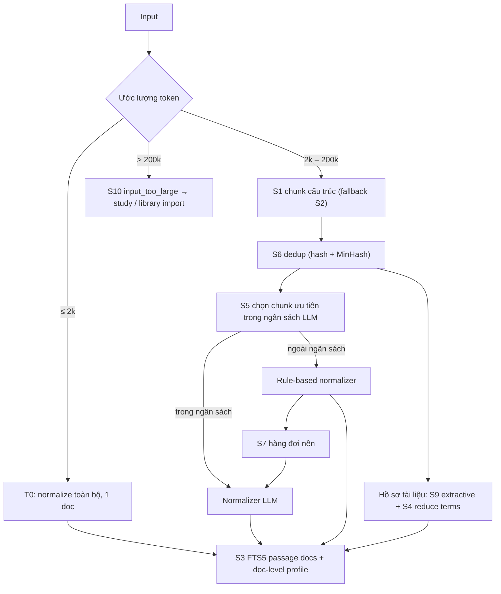

# PR01 — Giải pháp cho Input văn bản lớn

> Companion của [ARCHITECTURE-SPINE.md](ARCHITECTURE-SPINE.md) (AD-9). Liên quan FR-18..FR-20 trong [PRD](../../prds/prd-agent-memory-2026-10-20/prd.md).

## 1. Vấn đề cụ thể

Văn bản lớn (transcript session, log, tài liệu, sách trong library, output của `study`) gây ra 5 vấn đề với kiến trúc BM25 + normalizer LLM:

| # | Vấn đề | Vì sao |
|---|---|---|
| L1 | Vượt context window của normalizer | Model nhỏ thường có context 2k–8k token, nhưng một tài liệu có thể dài 100k+ token |
| L2 | Chi phí CPU/thời gian | Chuẩn hoá toàn bộ văn bản bằng LLM tốn thời gian tuyến tính theo độ dài |
| L3 | BM25 lệch theo độ dài | Tài liệu dài có TF cao ở nhiều term, nên chuẩn hoá độ dài (`b`) phạt hoặc thưởng sai lệch |
| L4 | Kết quả không định vị được | Khớp một tài liệu 50 trang thì agent không biết đoạn nào liên quan và tốn token khi recall |
| L5 | Trùng lặp | Log và transcript lặp lại nhiều, gây phình index và làm nhiễu TF |

## 2. Các phương án

### S1. Chunk theo cấu trúc (structure-aware chunking)
Tách theo heading Markdown, khối code, đoạn văn, lượt hội thoại (transcript) và block log (theo timestamp). Mỗi chunk dài 300–800 token, giữ `heading_path` làm field `title`.
- Ưu: chunk có nghĩa, giải quyết L1, L3, L4.
- Nhược: cần parser cho từng định dạng. Repo đã có `ingestion/` và `library` parser có thể tái dùng.

### S2. Cửa sổ trượt có chồng lấn (sliding window + overlap)
Chunk cố định khoảng 512 token, chồng lấn 10–15 %. Dùng khi không có cấu trúc.
- Ưu: đơn giản, áp dụng được mọi loại văn bản.
- Nhược: có thể cắt ngang ý; chồng lấn làm tăng kích thước index.

### S3. Index ở mức passage, gộp điểm ở mức tài liệu
Mỗi chunk là một doc trong FTS5 (`passage_id`). Khi tìm, gộp điểm về memory bằng `max` cộng một phần `sum(top-3)`.
- Ưu: giải quyết L3, L4. Recall trả về đúng đoạn cần thiết, tiết kiệm token budget.
- Nhược: số doc trong index tăng. Cần dedupe kết quả theo memory.

### S4. Chuẩn hoá phân cấp (hierarchical / map-reduce normalization)
- **Map**: chuẩn hoá từng chunk (song song có giới hạn).
- **Reduce**: gộp `canonical_terms` và `identifiers` của tất cả chunk thành hồ sơ cấp tài liệu (lấy top theo tần suất và vị trí), rồi lưu ở doc cấp tài liệu với field `expansions`.
- Ưu: giải quyết L1. Tài liệu vẫn tìm được bằng khái niệm tổng quát.
- Nhược: tốn CPU nhất.

### S5. Ngân sách chuẩn hoá (normalization budget) và lấy mẫu
Mỗi tài liệu có ngân sách LLM (ví dụ ≤ 32 chunk hoặc ≤ 20 giây CPU). Các chunk được ưu tiên theo: chunk đầu, chunk có heading, chunk có mật độ identifier cao, chunk chứa từ khoá lỗi. Chunk còn lại dùng rule-based normalizer và được đưa vào hàng đợi nền.
- Ưu: giới hạn chi phí L2 một cách cứng.
- Nhược: recall paraphrase của phần đuôi tài liệu thấp hơn cho tới khi worker nền xử lý xong.

### S6. Khử trùng lặp (dedup) trước khi index
- Hash chính xác theo chunk (`content_hash`) để bỏ chunk trùng.
- SimHash/MinHash cho near-duplicate (log lặp, transcript lặp lại).
- Gom các dòng log lặp thành mẫu kèm số lần xuất hiện.
- Ưu: giải quyết L5, thu nhỏ index, giảm chi phí LLM.
- Nhược: có rủi ro gộp nhầm. Cần ngưỡng an toàn và giữ lại offset gốc.

### S7. Ingest bất đồng bộ có hàng đợi và tiến độ
Văn bản lớn trả về `job_id` ngay. Worker xử lý theo lô, có `progress`, có thể huỷ và chạy tiếp sau restart. Memory ở trạng thái `normalization=pending` vẫn tìm được ngay bằng rule-based index.
- Ưu: write không bị block, đáp ứng p95 write.
- Nhược: tính nhất quán chỉ đạt được sau một khoảng thời gian (eventual consistency) với paraphrase.

### S8. Tách lưu trữ: raw ở document tier, chỉ index phần đã chuẩn hoá
Raw lưu ở document tier (lạnh, có thể nén). FTS5 chỉ index các field đã chuẩn hoá cùng `raw_body` của chunk đã cắt gọn. Khi recall thì lấy lại đoạn raw theo offset.
- Ưu: index nhỏ.
- Nhược: thêm một bước đọc khi recall.

### S9. Tóm tắt trích xuất (extractive summary), không sinh văn bản mới
Chọn ra các câu đại diện bằng thuật toán (TextRank hoặc điểm BM25 của câu so với hồ sơ tài liệu) làm field `title`/`summary`. Không dùng LLM để viết tóm tắt.
- Ưu: rẻ, xác định, không gây hallucination.
- Nhược: chất lượng tóm tắt kém hơn tóm tắt do LLM sinh ra.

### S10. Giới hạn cứng và từ chối có hướng dẫn
Áp trần (ví dụ 5 MB/tài liệu, 200k token). Vượt trần thì từ chối với lỗi `input_too_large` và gợi ý dùng `study`/library import (đường xử lý dành riêng cho tài liệu dài).
- Ưu: bảo vệ daemon khỏi cạn RAM/CPU.
- Nhược: người dùng phải đổi luồng làm việc.

## 3. So sánh

| Phương án | L1 context | L2 chi phí | L3 lệch độ dài | L4 định vị | L5 trùng lặp | Độ phức tạp |
|---|---|---|---|---|---|---|
| S1 structure chunk | ✓ | – | ✓ | ✓ | – | Trung bình |
| S2 sliding window | ✓ | – | ✓ | ✓ | ✗ | Thấp |
| S3 passage index | – | – | ✓ | ✓ | – | Trung bình |
| S4 map-reduce | ✓ | ✗ | – | – | – | Cao |
| S5 budget | – | ✓ | – | – | – | Thấp |
| S6 dedup | – | ✓ | ✓ | – | ✓ | Trung bình |
| S7 async queue | – | ✓ (UX) | – | – | – | Trung bình |
| S8 raw tách riêng | – | – | – | ✓ | – | Thấp |
| S9 extractive | ✓ | ✓ | – | – | – | Thấp |
| S10 hard cap | ✓ | ✓ | – | – | – | Thấp |

✓ = giải quyết, – = không ảnh hưởng, ✗ = làm tệ hơn.

## 4. Khuyến nghị: tổ hợp theo tầng kích thước

| Tầng | Kích thước | Xử lý |
|---|---|---|
| T0 nhỏ | ≤ 2k token | Đồng bộ: một doc, chuẩn hoá LLM toàn bộ |
| T1 vừa | 2k – 32k token | Đồng bộ phần đầu, phần còn lại bất đồng bộ: **S1 (fallback S2) + S3 + S6 + S5** |
| T2 lớn | 32k – 200k token | Bất đồng bộ: **S7 + S1/S2 + S3 + S6 + S5 + S9**, map-reduce rút gọn (S4) chỉ cho hồ sơ cấp tài liệu |
| T3 rất lớn | > 200k token hoặc > 5 MB | **S10**: từ chối, chuyển sang đường `study`/library import (đã có job, tiến độ, resume) |

## 5. Tham số mặc định đề xuất (tinh chỉnh bằng benchmark)

| Tham số | Giá trị |
|---|---|
| Kích thước chunk mục tiêu | 400 token (min 150, max 800) |
| Overlap (chỉ với S2) | 12 % |
| Ngân sách LLM mỗi tài liệu | 32 chunk hoặc 20 s CPU |
| Đồng thời normalizer | `max(1, cores/2)` |
| Gộp điểm passage | `max + 0.3 × sum(top-3 còn lại)` |
| Recall trả về | Passage khớp ± 1 passage lân cận, cắt theo token budget |
| Ngưỡng MinHash near-dup | Jaccard ≥ 0.9 |
| Trần cứng | 200k token hoặc 5 MB |

## 6. Rủi ro riêng

- Chunk cắt ngang khối code: S1 phải coi khối code là đơn vị không chia; nếu khối quá dài thì tách theo hàm hoặc dòng trống.
- Dedup gộp nhầm hai log khác nhau ở một tham số: giữ đủ danh sách offset để truy lại và hiển thị số lần lặp.
- Hàng đợi bị dồn khi ingest hàng loạt: giới hạn độ dài hàng đợi, ưu tiên memory mới, báo cáo qua `index status` và `/metrics`.
