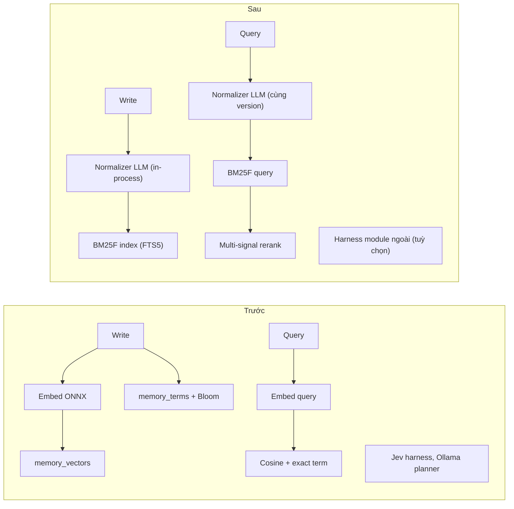
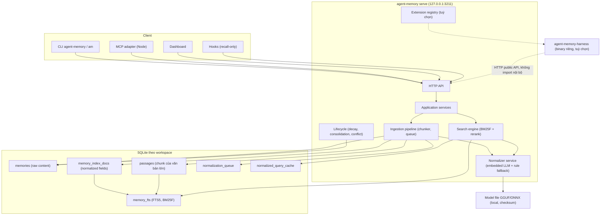
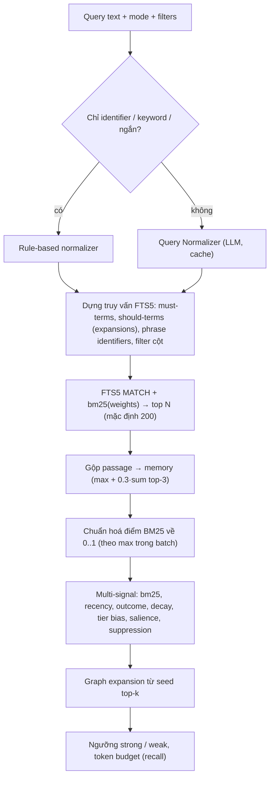
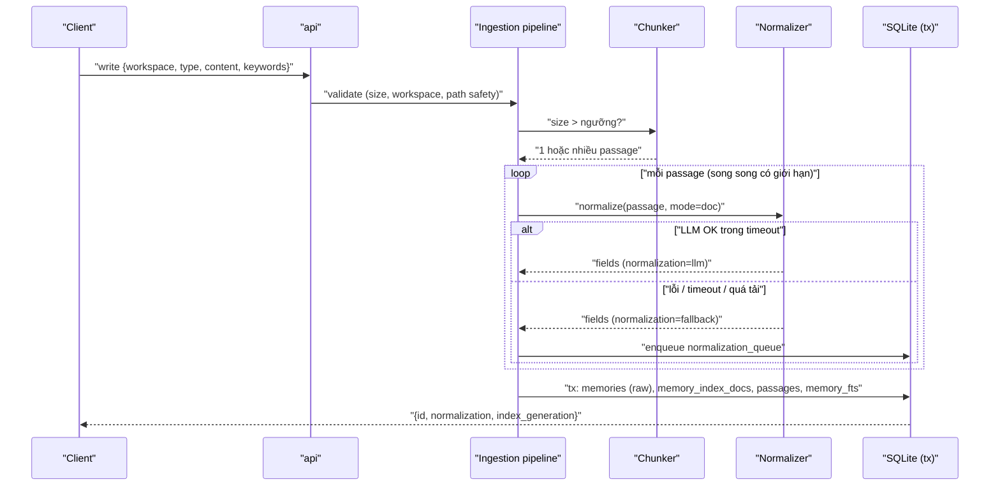
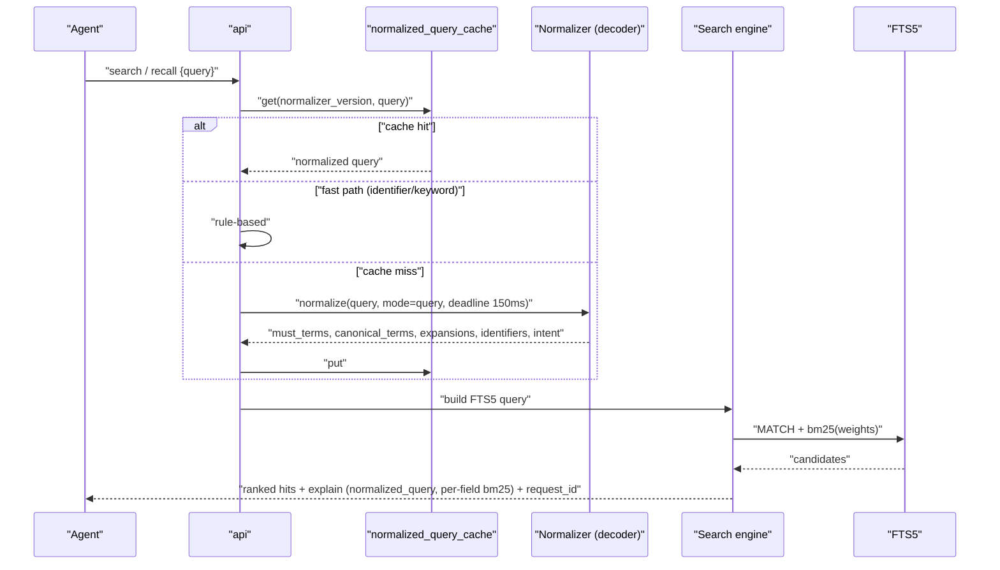
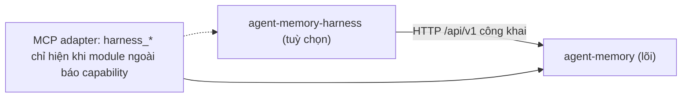
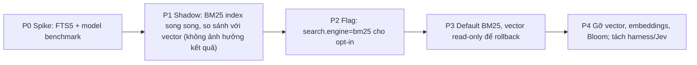

# PR01 — Kiến trúc đích: BM25-only + Embedded Normalizer LLM

> Companion của [ARCHITECTURE-SPINE.md](ARCHITECTURE-SPINE.md): spine giữ các quyết định ràng buộc (AD-n), còn tài liệu này giữ thiết kế chi tiết, phương án và lý do.
> Đầu vào: [PRD](../../prds/prd-agent-memory-2026-10-20/prd.md).
> Kiến trúc hiện tại: [docs/architecture](../../../../architecture/high-level-architecture.vi.md).
> Sơ đồ PlantUML: [diagrams/](diagrams/README.md).

## 1. Tổng quan thay đổi

| Lớp | Trước | Sau |
|---|---|---|
| Ứng viên truy xuất | Vector (ONNX MiniLM, cosine) + exact-term (Bloom + `memory_terms`) | **BM25F** trên một chỉ mục duy nhất |
| Paraphrase | Do embedding gánh | **Normalizer LLM** nhúng: mở rộng lúc ghi (doc expansion) và viết lại lúc hỏi (query rewrite) |
| Keyword / identifier | 3 locator exact match | Field `keywords` và `identifiers` trong BM25F, có tokenizer identifier riêng |
| Mini LLM | Ollama Qwen planner (dịch vụ ngoài, tuỳ chọn) | **Gỡ khỏi lõi** |
| Jev agent | Harness + advisory trong lõi | **Tách ra** module ngoài (`agent-memory-harness`), lõi chỉ giữ extension point |
| Egress của lõi | Tuỳ chọn (Jev, model provider, tải ONNX) | **Không có** (model normalizer cài một lần qua installer, có checksum) |

## 2. Kiến trúc container sau thay đổi

## 3. Thành phần chi tiết

### 3.1 Search engine (BM25F)

**Phương án lưu trữ chỉ mục**

| Phương án | Mô tả | Ưu | Nhược | Quyết định |
|---|---|---|---|---|
| A. SQLite FTS5 | Bảng ảo FTS5 nhiều cột, xếp hạng bằng `bm25()` có trọng số theo cột | Có sẵn trong SQLite, transaction cùng DB, ổn định, nhanh | `bm25()` của FTS5 dùng chung `k1`, `b` cho mọi cột (BM25 trọng số cột, không phải BM25F thật); tokenizer tuỳ biến trong pure-Go driver bị hạn chế | **Chọn** cho giai đoạn 1 |
| B. Chỉ mục postings tự viết | Bảng `terms`, `postings(term_id, doc_id, field, tf)`, `doc_stats`; tính BM25F trong Go | BM25F thật (k1/b theo field), toàn quyền tokenizer, explain chi tiết | Tự viết nhiều, phải tự tối ưu (WAND/MaxScore), I/O lớn hơn | Dự phòng nếu spike A thất bại hoặc cần BM25F đúng nghĩa |
| C. Bleve / Tantivy | Thư viện search ngoài | Nhiều tính năng | Thêm dependency, chỉ mục ngoài SQLite (mất atomic với dữ liệu), Tantivy cần cgo | Loại |

Chi tiết phương án A:
- **Pre-tokenize trong Go**: vì tokenizer FTS5 tuỳ biến khó làm với pure-Go driver, tokenizer của chúng ta (identifier-aware, tiếng Việt) chạy trong Go và ghi chuỗi token đã chuẩn hoá (cách nhau bằng khoảng trắng) vào các cột FTS5. FTS5 dùng tokenizer `unicode61` với `remove_diacritics 0` để chỉ tách theo khoảng trắng. Cách này đảm bảo **index và query dùng chung một tokenizer** viết bằng Go.
- **Cột FTS5**: `identifiers`, `keywords`, `title`, `normalized_body`, `expansions`, `raw_body`, cộng thêm các cột `UNINDEXED`: `memory_id`, `passage_id`, `workspace`, `type`, `tier`.
- **Trọng số mặc định** (tinh chỉnh bằng benchmark): identifiers 4.0, keywords 3.0, title 2.0, normalized_body 1.0, expansions 0.6, raw_body 0.3.
- **External content**: FTS5 ở chế độ `content=memory_index_docs` để không nhân đôi văn bản; trigger đồng bộ hoặc cập nhật tường minh trong transaction ghi.

**Pipeline truy vấn**

Ghi chú thiết kế:
- Điểm BM25 không bị chặn trên, nên phải chuẩn hoá theo batch (chia cho max, hoặc dùng `s/(s+k)`) trước khi trộn với các tín hiệu khác. Cách chuẩn hoá được ghi trong explain.
- Ngưỡng `min_semantic_score` hiện tại được thay bằng `min_bm25_norm` cùng ngưỡng tương đối so với best hit.
- Bloom filter hiện tại trở nên thừa với FTS5 (FTS5 tra term đã rất rẻ); giữ lại trong một release ở chế độ shadow để so sánh, sau đó gỡ.
- Query cache hiện có (`engine/query_cache.go`) giữ nguyên. Key bổ sung `normalizer_version` và `index_generation`.

### 3.2 Tokenizer (identifier-aware)

| Loại token | Quy tắc | Ví dụ |
|---|---|---|
| Identifier | Giữ nguyên dạng lowercase, đồng thời tách theo camel/snake/kebab/dot/slash | `RetrievalEngine.Retrieve` → `retrievalengine.retrieve`, `retrieval`, `engine`, `retrieve` |
| Path | Giữ toàn path và từng segment, bỏ đuôi file làm token phụ | `internal/engine/retrieval.go` → path, `internal`, `engine`, `retrieval`, `go` |
| Mã lỗi / số phiên bản | Giữ nguyên, không tách số | `ENOENT`, `v1.50.0`, `3211` |
| Từ thường (Anh) | lowercase, NFC, stopword tối thiểu, lemma theo từ điển (không dùng Porter stemmer để tránh làm hỏng identifier) | `running` → `run` |
| Tiếng Việt | Tách âm tiết, lưu **cả dạng có dấu và không dấu** (để gõ không dấu vẫn tìm được), bigram âm tiết cho từ ghép | `khởi động` → `khởi`, `động`, `khoi`, `dong`, `khởi_động` |

Tokenizer được version hoá (`tokenizer_version`). Đổi version thì phải reindex.

### 3.3 Normalizer service (embedded LLM)

**Vai trò**: biến văn bản tự nhiên thành **tập token chuẩn** để BM25 bắt được paraphrase, theo kiểu doc2query/query rewriting nhưng ràng buộc chặt chẽ.

**Hợp đồng output (schema cố định, ràng buộc bằng grammar)**

| Field | Kiểu | Giới hạn | Ý nghĩa |
|---|---|---|---|
| `language` | enum | `en`, `vi`, `mixed`, `other` | Chọn tokenizer |
| `canonical_terms` | list string | ≤ 32 | Khái niệm chuẩn hoá (lemma, dạng chuẩn của thuật ngữ) |
| `identifiers` | list string | ≤ 32 | Identifier trích xuất nguyên văn, **phải xuất hiện trong input** (kiểm sau giải mã) |
| `expansions` | list string | ≤ 16 | Từ đồng nghĩa và cách diễn đạt khác (paraphrase), chỉ dùng cho field `expansions` trọng số thấp |
| `intent` (chỉ query) | enum | `fact`, `how`, `debug`, `outcome`, `lookup` | Gợi ý mode/weights |
| `must_terms` (chỉ query) | list string | ≤ 8 | Term bắt buộc khớp |
| `normalizer_version` | string | — | `model_hash + prompt_version + grammar_version + tokenizer_version` |

**Lựa chọn runtime**

| Phương án | Ưu | Nhược | Quyết định |
|---|---|---|---|
| llama.cpp nhúng qua cgo (GGUF) | Hiệu năng CPU tốt, có grammar (GBNF) ràng buộc JSON, model nhỏ (0.5–1.5B, Q4) | Cần cgo, build đa nền tảng phức tạp hơn | **Chọn** cho bản build mặc định macOS/Linux |
| ONNX Runtime GenAI | Hạ tầng ONNX đã có sẵn trong repo (`embeddings/onnx_runtime*.go`) | Constrained decoding phải tự làm | Phương án B |
| Subprocess llama-server cục bộ | Không cần cgo trong binary chính | Thực chất lại là "mini LLM ngoài", trái với G2 | Loại |
| Chỉ dùng rule-based | Nhẹ, xác định tuyệt đối | Paraphrase yếu | Luôn có, dùng làm fallback |

**Model**: decoder nhỏ đa ngôn ngữ (Anh–Việt), khoảng 0.5B–1.5B tham số, lượng tử hoá Q4, kèm giấy phép cho phép phân phối lại. Model được ghim theo hash và kiểm checksum khi cài. Tên model cụ thể được chọn qua spike benchmark (Story 4.1). Tài liệu này **chưa chốt** model.

**Tính xác định**: greedy decoding, `temperature=0`, seed cố định, số thread cố định cho golden test, output qua grammar rồi qua validator (cắt độ dài, lọc identifier không có trong input, khử trùng lặp, sắp xếp ổn định).

**Vì sao không phải "mini LLM" cũ?** Planner Ollama là dịch vụ ngoài, tác vụ mở (lập kế hoạch), output tự do. Normalizer chạy in-process, làm đúng một tác vụ hẹp, output có schema, có fallback xác định, và không bao giờ là điều kiện bắt buộc để ghi hay tìm thành công.

### 3.4 Luồng ghi (ingest)

- Văn bản ngắn chạy đồng bộ. Văn bản lớn chạy bất đồng bộ: trả về `job_id` ngay, phần còn lại xem tài liệu 04.
- Worker nền xử lý `normalization_queue` (fallback → LLM) và reindex khi `normalizer_version` đổi, theo lô, có giới hạn CPU.
- Consolidation và conflict detection hiện đang dùng độ tương đồng embedding. Sau thay đổi sẽ dùng **độ tương đồng BM25 / Jaccard trên `canonical_terms`** (MinHash cho tập lớn).

### 3.5 Luồng tìm (query)

Nếu normalizer quá deadline, hệ thống trả kết quả từ rule-based và gắn cờ `normalization=fallback` trong explain. Truy vấn không bao giờ thất bại chỉ vì LLM.

### 3.6 Tách Jev agent và mini LLM

| Nhóm package | Hành động |
|---|---|
| `harness`, `harnessrun`, `harnesscontext`, `harnessmodel`, `harnesstools`, `harnessdecide`, `harnessapproval`, `harnessauth`, `harnessfs`, `harnessgit`, `harnessexec`, `harnessworker`, `harnessjev`, `harnessproof` | Chuyển sang module `agent-memory-harness` (repo hoặc Go module riêng). Module này chỉ gọi lõi qua HTTP API công khai |
| `jev`, `jevconfig`, `modelroute`, `openaiapi`; `cli/{harness_*,jev_*}.go`; phần Jev trong `listen_command.go` | Chuyển theo harness. `listen` trong lõi chỉ còn `on/off/status` (recall cục bộ) |
| `bootstrap/ollama.go`, `localllm`, cờ `--with-local-llm`, `--local-llm-model`; `api/local_llm_handler.go` | Gỡ khỏi lõi. Tính năng dịch của library chuyển sang Normalizer (nếu cần) hoặc bị loại |
| `--local-graph-model` (GraphRAG qua Ollama) | Ngoài phạm vi PR01; GraphRAG adapter vẫn tách biệt như hiện tại. Cần quyết định riêng (Q4 ở §10) |
| `embeddings`, `turbovec.go`, `vectors.go`, `reembed`, `model_version_check` | Gỡ sau khi E7 xác nhận BM25 đạt chỉ tiêu (giữ một release ở chế độ đọc để rollback) |

Extension point trong lõi: một registry nhỏ cho phép binary ngoài khai báo capability qua `/api/v1/capabilities`. Lõi **không import** module ngoài.

## 4. Mô hình dữ liệu mới

| Bảng | Khoá | Cột chính | Ghi chú |
|---|---|---|---|
| `memories` | `id` | giữ nguyên; thêm `normalization` (`llm`/`fallback`/`pending`), `index_generation` | Nội dung gốc không đổi |
| `memory_index_docs` | `doc_id` | `memory_id`, `passage_id` (nullable), `workspace`, `identifiers`, `keywords`, `title`, `normalized_body`, `expansions`, `raw_body`, `normalizer_version`, `tokenizer_version` | Nguồn external content của FTS5 |
| `memory_fts` | rowid = `doc_id` | FTS5 trên 6 cột text | `content=memory_index_docs` |
| `passages` | `passage_id` | `memory_id`, `ordinal`, `start_offset`, `end_offset`, `heading_path`, `token_estimate`, `content_hash` | Chỉ có khi văn bản lớn |
| `normalization_queue` | `id` | `doc_id`, `reason` (`fallback`/`version_change`), `attempts`, `next_at` | Worker nền |
| `normalized_query_cache` | (`normalizer_version`, `query_hash`) | `payload`, `created_at`, `hits` | LRU theo kích thước |
| `index_state` | `workspace` | `index_generation`, `tokenizer_version`, `normalizer_version`, `bm25_weights`, `rebuild_cursor` | Theo dõi migration và reindex |

Bảng bị loại dần: `memory_vectors`, `memory_terms`, `term_index_state` (sau giai đoạn shadow).

## 5. Thay đổi API / MCP

| Bề mặt | Thay đổi | Tương thích |
|---|---|---|
| `POST /memories/search`, `/recall` | Thêm `explain.normalized_query`, `explain.bm25_fields`, `normalization` | Chỉ thêm field |
| Tín hiệu `semantic` trong explain | Đổi tên thành `lexical`; giữ alias `semantic` trong một release | Có alias |
| `POST /memories/write` | Thêm `normalization`, `job_id` (văn bản lớn) | Chỉ thêm field |
| `/api/v1/harness/*`, MCP `harness_*` | Gỡ khỏi lõi; trả `capability_removed` | Thay đổi phá vỡ có chủ đích, kèm thông báo |
| `/api/v1/library/local-llm*` | Gỡ | Như trên |
| Lệnh mới | `agent-memory index status|rebuild`, `agent-memory normalizer status|test` | Mới |
| Lệnh bỏ | `reembed`, `install --with-local-llm`, `harness …`, `listen jev-*` | Thông báo deprecation một release trước |

## 6. Phương án thay thế đã cân nhắc

| Phương án | Vì sao không chọn |
|---|---|
| Giữ hybrid BM25 + vector | Trái với G1; vẫn phải mang ONNX runtime |
| BM25 + SPLADE (sparse learned) | Vẫn là inference mô hình nơ-ron ở mọi lần ghi và truy vấn, và vẫn cần runtime; có thể xem xét sau như "expansions" học được |
| Chỉ query rewrite, không doc expansion | Rẻ hơn lúc ghi nhưng paraphrase một chiều; recall kém hơn với câu hỏi ngắn |
| Chỉ doc expansion, không query rewrite | Query tự nhiên dài nhiều nhiễu; mất `must_terms` và intent |
| Gọi LLM qua Ollama | Chính là "mini LLM" người dùng yêu cầu bỏ |

## 7. Hiệu năng và quy mô

| Hạng mục | Ước lượng / biện pháp |
|---|---|
| FTS5 query 50k doc | Vài ms đến vài chục ms tuỳ số term; giới hạn `should_terms` ≤ 24 |
| Normalizer CPU | Model ~1B Q4: dự kiến 20–60 token/s trên laptop. Output ≤ ~150 token → query cold ≈ vài trăm ms. **Phải đo trong spike Story 4.1**, chưa phải số đã kiểm chứng |
| Giảm tải | Cache query; fast path; batch ingest; giới hạn đồng thời (semaphore = số core / 2); unload model khi idle |
| Văn bản lớn | Chuẩn hoá theo passage, có ngân sách token cho mỗi tài liệu (xem 04) |
| Kích thước index | FTS5 thường bằng 0.5–1.5 lần văn bản đã token hoá; dùng external content để tránh nhân đôi |

## 8. Bảo mật và quyền riêng tư

- Lõi không có egress. Model được cài một lần với checksum ghim. Không auto-download khi runtime.
- Normalizer có thể bị prompt injection từ nội dung memory. Giảm thiểu: output bị ràng buộc schema, identifier phải có trong input, expansions chỉ vào field trọng số thấp, và output không bao giờ được thực thi hay dùng làm policy.
- Redaction hiện có (`engine/redact.go`) chạy **trước** normalizer để secret không lọt vào `expansions`.
- Gỡ Jev đồng nghĩa với gỡ bề mặt cấp quyền harness, giảm attack surface của daemon.

## 9. Rủi ro và giảm thiểu

| Rủi ro | Khả năng | Tác động | Giảm thiểu |
|---|---|---|---|
| Recall paraphrase thấp hơn vector | Trung bình | Cao | Bộ paraphrase test làm cổng release; tinh chỉnh expansions; feature flag rollback về vector trong 1 release |
| Lệch normalizer giữa index và query | Trung bình | Cao | `normalizer_version` trên mọi doc và query cache; reindex nền khi đổi version; golden test |
| LLM chậm trên máy yếu | Cao | Trung bình | Fast path, cache, deadline, rule-based fallback; cấu hình tắt LLM hoàn toàn |
| cgo làm khó build/phát hành | Trung bình | Trung bình | Build tag: `normalizer_llm` (cgo) và `normalizer_rules` (pure Go); Homebrew build từ source |
| FTS5 không có trong driver hoặc bị giới hạn | Thấp | Cao | Spike Story 1.1 đầu tiên; phương án B (postings tự viết) |
| Người dùng phụ thuộc harness/Jev | Trung bình | Trung bình | Module ngoài, thông báo deprecation, `doctor` hướng dẫn |
| Consolidation/conflict giảm chất lượng khi bỏ embedding | Trung bình | Trung bình | MinHash/Jaccard trên `canonical_terms`; benchmark riêng |

## 10. Câu hỏi mở (cần người dùng quyết định)

| # | Câu hỏi | Mặc định đề xuất |
|---|---|---|
| Q1 | Jev/harness: tách thành module ngoài hay xoá hẳn? | Tách thành module ngoài, đóng băng bảo trì |
| Q2 | Chấp nhận cgo (llama.cpp) cho build mặc định? | Có trên macOS/Linux; Windows dùng rule-based |
| Q3 | Model normalizer cụ thể và giới hạn RAM | Chọn qua spike, ≤ 1 GB file, ≤ 1.5 GB RAM |
| Q4 | GraphRAG local model (`--local-graph-model` dùng Ollama) có bị gỡ cùng mini LLM không? | Giữ adapter Python, bỏ tuỳ chọn Ollama |
| Q5 | Tính năng dịch của library (`localllm/translate`) | Bỏ ở PR01, đánh giá lại sau |

## 11. Rollout

Cổng chuyển giai đoạn: benchmark Recall@10, bộ paraphrase test, p95 latency (theo PRD §7 Success Metrics, SM-1..SM-5). Rollback: P2/P3 đổi flag về vector; P4 chỉ thực hiện sau một release ổn định.

Việc tách Jev/mini LLM (E2) độc lập với retrieval nên có thể chạy song song từ P0. Bước xoá khỏi lõi nên rơi vào P4 để gom thay đổi phá vỡ vào một release.
